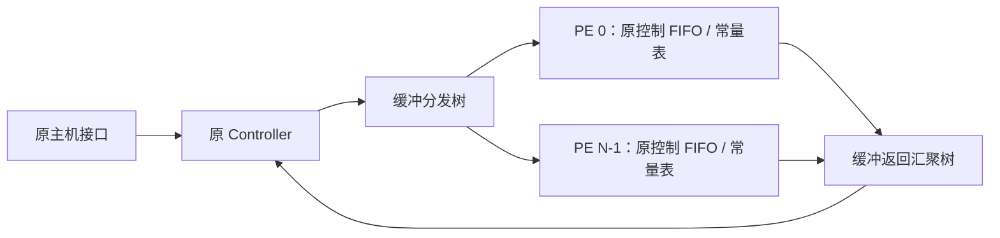

# 可选控制分发与返回汇聚网络

本次优化以 **`03db4c735dc9573ee19d5080eb123cc106333ba3`** 为唯一原实现。
默认仍使用该提交的信用环；新增两个可选后端和仅针对 CONFIG 的组播。
原 PE、控制存储、常量表和计算数据网络接口不变，运算、路由、寄存器选择和常量仍在运行时加载。
实现和实验均不依赖未提交的 FPGA 或卷积工程。

## 1. 源码设计及接口变化

| 参数 | 含义 |
|---|---|
| `CTRL_NETWORK=0` | 默认，原 `cgra_credit_ring`；原 VC=2、credit=2 不变 |
| `CTRL_NETWORK=1` | 按叶节点数平衡的二叉分发树、独立返回汇聚树 |
| `CTRL_NETWORK=2` | 优先按完整行分组，再拆分行内节点的二叉树 |
| `CTRL_MULTICAST=0/1` | 是否启用新后端的 CONFIG 组播；默认为 0 |
| `HAS_CTRL_RING=0` | 保持原来的控制端口断开语义；与新后端同时使用会明确报错 |

`COLS/ROWS` 决定实际叶节点，编号 `y*COLS+x`。Controller 节点仍是
`NUM_TILES=COLS*ROWS`，并非 `MAX_TILES`。最大几何仅决定包字段容量和外部数组边界；
额外位置没有 PE，不能成为配置目标。没有增加 PE 端口或缩短数据位宽。



两棵树传递完整 `HOST_BITS` 包，保留来源、目的、命令、数据、控制字及其他字段。
叶节点只补入具体目的 PE；公开 VC 位重现原 native 环的最短路径/dateline 标记，
而新网络内部没有环形通道或物理 VC。普通命令仍逐包单播。

| 文件 | 改动职责 |
|---|---|
| `rtl/noc/cgra_ctrl_network.sv` | 根命令解码、掩码装载、合法目标、上下行及公开字段绑定 |
| `rtl/noc/cgra_ctrl_fanout.sv` | 递归分发、每包目标快照、逐子树交付记账 |
| `rtl/noc/cgra_ctrl_gather.sv` | 递归汇聚、双输入公平仲裁、完整返回包 FIFO |
| `rtl/cgra/cgra_system.sv` | 后端选择和不支持 profile 的 RTL 拒绝 |
| `rtl/controller/cgra_controller.sv` | 原分派之外增加两个有条件启用的原生命令 |
| `rtl/common/cgra_profile_defs.svh` | 新参数及层级透传 |
| `rtl/common/cgra_ctrl_commands.svh` | 两个新增命令号，独立于原 Python 命令 |
| `tools/abi.json` | 包 ABI、命令及能力表 |
| `tools/cgra_config.py`、`tools/cgra_program.py` | 参数校验、组播编码、显式批次合并、展开检查 |
| `filelists/native.f`、`filelists/control_network.f` | 整机和网络独立构建入口 |
| `tests/control_network/` | 单播、组播、数学、归约、能力边界和综合台架 |

原 `cgra_credit_ring/router/route/switch/credit_*` 和通用队列源码保持基线字节一致。
基线 switch 已有独热 grants、停顿锁定和握手后推进；其数据选择是循环赋值形成的选择结构。
本次没有重复宣称完成独热数据选择优化，也没有全局替换其他使用信用环的模块。

建议在已开放的单 CGRA profile 中先选 `CTRL_NETWORK=1`，对明确可合并的配置批次启用组播；
平衡分组具有直接的规模扩展规则。`CTRL_NETWORK=2` 保留为物理行分组对照；
当前综合差异很小，尚不能证明哪一种布线后更好。其余 profile 继续选默认环。

## 2. 完整命令路径与能力边界

Controller 与 Tile 的接收列表不同。下表列出基线全部 0…58 命令的去向；
能够打包或 Controller 能转发，都不等于 Base Tile 能执行。

| 命令号及名称 | 基线路径 / 使用者 | 本次专用后端 |
|---|---|---|
| 0 LAUNCH；3 CONFIG；4/5/6 三种 PROLOGUE；7 TOTAL_CTRL_COUNT；8 COUNT_PER_ITER | Controller → 控制网 → PE → ctrl_mem | 保留单播，CONFIG 可组播 |
| 13 CONST | Controller → 控制网 → PE 常量表 | 保留单播、接收容量背压 |
| 20/21 GLOBAL_REDUCE_ADD/MUL_RESPONSE | Controller → 控制网 → PE → FU 返回队列 | 保留；真实全局加/乘请求响应测试 |
| 28/29/30 CONFIG_LOOP_LOWER/UPPER/STEP；43 CONFIG_GEP_STRIDE | Controller → 控制网 → PE/FU | 保留原消息路径，不扩展 FU 原有能力 |
| 1 PAUSE；2 TERMINATE；9 CTRL_LOWER_BOUND；15 RESUME；16 RECORD_PHI_ADDR；22 PRESERVE | Controller 可转发；Context 等变体的任务控制 | 新后端仅支持 Base，工具拒绝这些 Base 不接收的命令；原环和原变体保留 |
| 23/24/25 CONFIG_STREAMING_LD_* | Controller 可转发；Streaming Tile | 继续使用环后端 |
| 10 LOAD_REQUEST；11 LOAD_RESPONSE；12 STORE_REQUEST | Controller/SPM/数据 NoC 路径；并非把所有访存都送进控制环 | 原路径保留，完整公开主机回读测试 |
| 14 COMPLETE | PE → 控制网 → Controller → CPU | 完整包汇聚，保留每 PE 顺序 |
| 17 GLOBAL_REDUCE_COUNT | Controller 本地全局归约计数配置 | 原路径保留 |
| 18/19 GLOBAL_REDUCE_ADD/MUL | PE → 控制网 → Controller 归约单元 → 20/21 返回 | 上下行独立，保留完整数据；原 REDUCE 兼容开关语义不变 |
| 31 LEAF_COUNTER_COMPLETE | Controller 接收并消耗 | 传输不删字段；不据此宣称已接入系统 LoopController |
| 26 UPDATE_COUNTER_SHADOW_VALUE；27 RESET_LEAF_COUNTER | 存在于 ctrl_mem/FU 分支，基线 Controller/Tile 完整链未开放 | 工具拒绝，未新增整机能力 |
| 32…42 LC_CONFIG_*、LC_LAUNCH/SYNC/CHILD/ALL_* | 独立 LoopController API；基线无完整主机分派路径 | 未开放，专用 profile 工具明确拒绝 |
| 44…48 DMA_CONFIG_*；49/50 DMA_MVIN/MVOUT；51 DMA_DONE | Controller 的可选 DMA 路径 | 新后端不开放 DMA，仍用原环配置 |
| 52…58 IM2COL_LAUNCH/H/W/KH/KW/LOG2_STRIDE/DST_SRAM_BASE | 可选 im2col 外设 | 新后端不开放 im2col，仍用原环配置 |

新后端的静态范围是：`top=system`、单 CGRA、Base Tile、native NoC、
`HAS_CTRL_RING=1`、`HAS_DMA=HAS_IM2COL=0`。Base 原有 4/8 端口约束不变。
配置工具和 RTL 均检查这些条件；没有悄悄降级或改变 `HAS_CTRL_RING=0`。
其他 FU/内存兼容参数仍受各自原契约约束；此实验不重新证明它们的所有组合。
Context 迁移/任务切换、Streaming、多 CGRA 和 legacy NoC 继续选择 `CTRL_NETWORK=0`。
没有更改它们的控制协议，也没有宣称用新树验证了这些场景。

## 3. CONFIG 组播 ABI 和保序

原 59 个命令和原字段布局不变，新增原生命令：

| 命令 | 格式 / 生效条件 |
|---|---|
| 59 `CTRL_MASK_WORD` | `payload.data_addr` 为掩码字序号，`payload.data.payload` 为 `DATA_W` 位目标片段 |
| 60 `CONFIG_MULTICAST` | 使用已装载的目标掩码，携带原 `ctrl_addr` 和完整 `ctrl`；叶端变回 CONFIG=3 |

掩码长度是 `ceil(NUM_TILES/DATA_W)` 个字，bit t 指向 PE t。字 0 开始或重启装载，
其他字必须连续，末字超出实际 PE 的位必须为零。全部装载完成且非空才允许组播。
相同掩码可以复用；复位使掩码无效。非法字序、空目标、未完成掩码和 padding 位在工具中拒绝，
RTL 仿真报告明确错误；硬件不接受非法事务，不提供错误响应包。

每个下行 FIFO 项保存 **完整包和目标子掩码的快照**，之后更新根掩码不会改变在途事务。
分叉为两个子树保存已接收位，只向尚未接收的选中子树提供 valid；二者都接收后才释放头项。
因此某目标 ready 较早不会重复写入，未选 PE 不接收，停顿中的包和剩余目标保持稳定。
一个组播包在公共上游只传一次，在分叉处复制；Controller 没有把它展开成若干单播。

每个目标只经过唯一 FIFO 路径，不会被后续 CONFIG、CONST 或 LAUNCH 越过。
PE 的 CONFIG 与 LAUNCH 进入同一原控制 FIFO，配置写入先于后续 LAUNCH 的处理；
CONST 则在叶端接收时已写入常量表。无需为每条配置增加回执，也无需等待 CONST 被计算消费。
整机观察器只读实际控制存储写端口和执行退役事件，检查该顺序，没有通过内部写存储配置 DUT。

自动合并限于调用者显式声明的一个 `config_batch`：建立各 PE 的有序 CONFIG 队列，
仅合并当前队头具有相同地址和完整控制字的项。对同地址的多次覆盖不会颠倒；
不跨 CONST、LAUNCH、其他命令、barrier 或批次边界合并。展开后的每 PE 有序消息流必须等于原流。
调用者负责把批次放在允许跨 PE 重排的配置阶段；对正在运行、存在跨 PE 配置时序依赖的程序应使用单播。

```json
{
  "schema": 1,
  "steps": [{"kind": "config_batch", "multicast": true, "writes": [
    {"tile": 0, "address": 0, "ctrl": {"operation": "ADD"}},
    {"tile": 1, "address": 0, "ctrl": {"operation": "ADD"}}
  ]}]
}
```

这是配置语法片段，完整运行案例由 `system.py`、`reduction.py` 生成。
两目标组播若每组重载一个掩码，发送包数与两个单播相同；小组未必节省包数。
工具不预设压缩比例，结果报告将掩码设置包计入总包数。

## 4. 缓存、仲裁及无死锁前提

每棵 N 叶二叉树有 `2N-1` 个节点，每节点一个 2 项正常 FIFO。
下行包宽为 `HOST_BITS+该子树叶数`，上行保存完整 `HOST_BITS`；
内部下行分叉另有两个交付状态位，上行每个合并点复用 native 双输入 `cgra_switch`。
总计每方向 `2*(2N-1)` 个 FIFO 槽位，未删掉缓存和背压。

FIFO ready 只依赖已寄存占用状态，不依赖下游 ready，树间也无组合交叉连接。
上行仲裁停顿时锁定选择，仅在握手后轮转；持续请求的子树在出口可推进时轮流得到服务。
层级轮转保证持续请求叶节点最终被服务，但不是所有叶子的逐拍全局平等份额。
网络测试包含持续竞争和多个 PE 同时返回。

下行依赖沿根到叶，上行依赖沿叶到根，二者物理独立，没有环形缓冲依赖，因而不需要沿用
环网的 VC/dateline/credit 硬件。这不是把原环的 VC/credit 减为 1。端点握手和在途缓冲仍完整存在。
无网络内部死锁的结论以前提为限：输入合法、生产者阻塞时保持 valid/message、外部背压有限、
端点最终能消耗头项、归约参与数及程序依赖正确。常量超过表容量后再发 LAUNCH、缺少归约参与者、
或永远不 ready 的消费者都不满足此前提，任何新拓扑都不能保证这些程序完成。

整机归约测试确实产生 PE 请求并经 Controller 返回，检查数值和完整内存。
跨 PE 返回允许原协议不约束的交错；同 PE 顺序和完整消息保持。
复位清空两树、交付位和掩码，丢弃复位前未完成事务；主机必须重新发送配置。

Base 的重复任务沿用基线语义：LAUNCH 不清除累计控制步数或常量表。
验证中的两任务在一次复位后运行，预装两组常量，第二任务改写控制字并增加累计步数预算；
不能把第二次 LAUNCH 当作一次隐含复位。Context 切换仍归原环后端验证。

## 5. 资源与周期指标

原环每节点有三个输入信用单元，每输入两个 VC，各两项；三个出口均需对六路完整包仲裁，
另有注入/弹出适配、信用计数、路由及公开 VC 保存。主要潜在成本是多份宽 FIFO 和宽数据选择，
仲裁/路由/信用控制也有成本。本次未做逐类消融，不能把某一百分比归因到其中一项。
专用树利用 Controller 单根与 PE 返回单根的通信关系减少通用转发逻辑，完整包宽仍然保留。

平衡树减少逻辑深度；按行树方便物理区域划分。它们都可能随规模增加面临上层宽线、布线、
扇出和单根吞吐瓶颈；每个 FIFO 出口至多一包/周期。行分组在非方阵可能更深；
两者都需要指定器件的布局布线确认，不能由 RTL 层数判断频率最优。
任一子树长期阻塞可填满共同祖先 FIFO，并拖住其他目的的后续命令；组播的慢目标也会带来
这种队头阻塞。新增后端保留背压与顺序，延迟需要按具体包流实测，不能由节点数推断。

`synth.py` 对相同完整 payload、背压、可变目的、DATA_W、最大几何和参数运行
`synth_xilinx -family xc7 -flatten -noiopad -noclkbuf`，另运行 `check -assert`、`scc -expect 0`。
这是控制网络独立模块的通用映射，未包含 Controller、PE、FU、SPM 或时钟/IO 资源。
逻辑 LUT1…6 与 LUTRAM 原语分别报告，不能将 LUTRAM 从实际 FPGA LUT 面积中忽略。
本环境没有器件工程、XDC、Vivado、布局布线或板卡证据；FF/BRAM/DSP 是综合映射计数，
setup/hold、最高频率及布局布线后 LUT 均 **未测**。不同后端不能借这些计数宣称完整系统面积或频率改善。
整机 Verilator 仍报告基线数据路由/寄存器路径的 `UNOPTFLAT` 警告；
本次独立控制网络的 SCC 检查不构成全系统无组合环的证明。

整机指标来自正常主机接口，记录 H=主机包接受、I=网络根接受、D=目标 PE 接受、
W=实际控制存储写入、E=控制步退役、S=PE STORE 接受、U=网络接受 PE 返回、O=主机接收返回。
S 不冒充外部存储提交。报告包含：

- 配置传输：首个 CONFIG/掩码主机接受到最后实际控制写入，包含掩码开销；另列 H/I/D/W 时间。
- 启动：第一/最后 LAUNCH 的主机与目标接受，以及每 PE 首次控制步退役。
- 准备：首个主机包到首次退役，包含数据预加载、常量、程序设置；不包括复位。
- 计算：首次到末次控制步退役的跨度；其中包含数据流等待，不等于纯算术流水线周期。
- 任务：首个主机包到收到全部所需完成；完成后继续完整结果回读。
- 返回排空：首个 PE 返回接受到最后主机 COMPLETE；归约期间返回与计算可能重叠。
- 驱动总周期：包含数据预加载、结果回读和完成后 32 个观察周期，区别于任务边界。

这些区间可能重叠，不应把各项简单相加。结果文件保留原始边界；
实际对照和各规模计数见 [实验结果](results/control-network/README.md)。

## 6. 可复现执行与验收

```bash
python3 sv/scripts/install_toolchain.py
source sv/build/toolchain/env.sh
make -C sv current-control-network
make -C sv current-control-network-synth
python3 sv/scripts/regression.py --shard control-network
```

独立命令、较小输出目录与选择单组的方式：

```bash
python3 sv/tests/control_network/system.py --baseline-rtl --cases 2x2:0:0,4x4:0:0 --output sv/build/control-network/pinned-system
python3 sv/tests/control_network/run.py --output sv/build/control-network/network-final
python3 sv/tests/control_network/run.py --backends 1,2 --multicast --geometries 2x2,3x3,4x4,2x3,3x2,2x17 --output sv/build/control-network/multicast-final
python3 sv/tests/control_network/system.py --cases 2x2:0:0,2x2:1:0,2x2:2:0 --output sv/build/control-network/system-stage-a
python3 sv/tests/control_network/system.py --cases 2x2:1:1,2x2:2:1 --output sv/build/control-network/system-stage-b
python3 sv/tests/control_network/system.py --cases 4x4:0:0,4x4:1:1,4x4:2:1,2x3:0:0,2x3:1:1 --output sv/build/control-network/system-large
python3 sv/tests/control_network/reduction.py --output sv/build/control-network/reduction
python3 sv/tests/control_network/guards.py --output sv/build/control-network/guards
python3 sv/tests/control_network/synth.py --output sv/build/control-network/synth
python3 sv/tests/control_network/collect.py --input sv/build/control-network
python3 sv/tests/control_network/collect.py --check
```

验收包括五种必需几何、NUM/MAX 不等的非方阵、34 PE 的两字掩码、随机有限背压、
目标不同步、连续配置、同地址覆盖、在途部分接收复位、多个同时返回、持续竞争公平性；
整机以同一硬件运行 `x+17` 与 `3*x+11`，改变路由、操作、常量和输入，逐字检查全部 32 字内存。
原始环硬件另从固定提交提取全部 RTL、头文件和配置工具编译，不使用工作树 RTL 替代原 DUT。
三个后端再做真实全局加/乘、两任务无复位重用。故意错误期望必须被检出，非法 profile 和掩码必须拒绝。

阶段 A 的单播与阶段 B 的组播独立列结果。未运行全仓库所有历史/系统测试，远端 CI 也需单独观察；
局部回归和通用综合不等于物理 FPGA 验收。后续器件实验应固定器件、XDC、时钟、工具、
程序、输入、FU/内存与 seed，分别保存综合层级和实现后的 LUT/FF/BRAM/DSP、setup/hold 报告。
