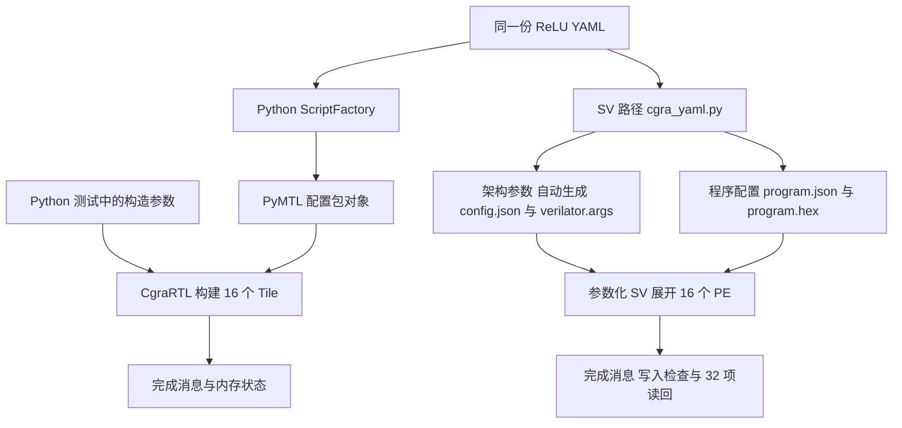

# VectorCGRA 迁移工程导览与 ReLU 案例

[HTML 阅读版](migration-guide.html)包含可搜索的完整逐文件索引和 ReLU Tile／控制字交互。GitHub 文件页不会执行 HTML；下载后用浏览器打开。本文为可直接在 GitHub 阅读的文字版本。

> 文件清单冻结于 2026-10-15 整理时的工作树，共 3,832 个文件；包含当时 24 个新增文件和 16 个已修改文件。相关清理改动仍单独保留，本次文档提交不包含它们；因此清单不是该提交 checkout 后的实时文件集合，也不包含本次新增的文档。源码链接固定到 d68d334，条目中标明了工作树与提交版本的差异。

## 迁移目录与项目构成

本工程把原 Python／PyMTL 的 CGRA 硬件描述迁移到 `sv/rtl/` 的 SystemVerilog 实现。理解迁移先从工程结构开始：硬件在哪里，参数和程序从哪里进入，测试又如何判断结果。随后只沿着你提供的 ReLU YAML，对照 Python 与 SV 的完整执行链。

**本例已经完成组合内存模式下的原生 SV 执行与结果验收。** 这个结论对应后文的 4×4、II=5、32 元素 ReLU；工程清单用来说明实现构成，不将文件数量当成功能完整性证明。

### 迁移工程放在哪里

```text
vectorcgra-v/
├── cgra/、tile/、fu/、mem/、noc/…   原 Python/PyMTL 实现和测试
├── validation/                    原程序与 YAML 测试
└── sv/                            迁移后的 SV 工程
    ├── rtl/                       硬件实现与必要第三方 HDL
    │   ├── cgra/                  单阵列与多阵列顶层
    │   ├── tile/                  PE 核心、路由和变体
    │   ├── fu/                    标量、向量、浮点、组合、访存 FU
    │   ├── mem/                   数据存储、控制存储和寄存器
    │   ├── controller/            主机控制、全局归约与循环控制
    │   ├── noc/                   控制环、仲裁和跨 CGRA 网络
    │   ├── peripheral/            DMA、im2col 与集成包装
    │   ├── common/                参数、消息类型和公共原语
    │   └── vendor/                实际使用的 HardFloat HDL 与来源
    ├── tools/                     架构、程序与 YAML 前端
    ├── examples/                  架构 JSON、程序 JSON、YAML
    ├── filelists/                 明确编译哪些 HDL
    ├── tests/                     原生测试及对照测试
    │   └── legacy/rtl/            旧顶层、旧标量链和固定类型包
    ├── reference/                 冻结的 Python HDL、轨迹与来源
    │   ├── legacy/                冻结的早期 2×2 golden 内核
    │   └── vendor/alu_gen_mac/     原始 MAC golden 源码与许可
    ├── vectors/                   早期冻结输入与期望向量
    ├── migration_tools/           迁移期导出、捕获、审计工具
    ├── scripts/                   构建、回归、打包与证据管理
    ├── results/                   保存的结果摘要与证据索引
    ├── diagrams/                  架构图及其生成工具
    ├── licenses/                  来源与依赖许可
    ├── Makefile                   工程命令入口
    ├── README.md 等               项目指南、接口契约和验收记录
    ├── build/                     运行时生成，Git 忽略
    └── artifacts/                 可选详细证据归档，Git 忽略
```

这里的“SV 工程”仍包含 Python **软件工具**。例如 `cgra_yaml.py` 把映射翻译为控制包；它不调用原 PyMTL RTL 来生成本例的硬件。正常原生编译直接使用已维护的 SystemVerilog，YAML 前端另需 PyYAML。

### 各目录的职责

以下目录结构已按 2026 年 10 月 16 日的整理更新：核心 `rtl/` 保留当前功能实现和独立硬件 API，旧实现移入测试区，冻结参考移入参考区。完整路径对应见 [RTL_LAYOUT.md](../RTL_LAYOUT.md)。逐文件索引保留最初盘点范围，并为迁出的条目显示新路径。

| 目录或入口 | 作用及阅读方式 |
|---|---|
| `rtl/` | 实际硬件描述。先读 `cgra_system.sv`、`cgra_pe.sv`，再沿实例深入。 |
| `tools/` | 架构参数验证、程序打包和 YAML 翻译；不承担布局布线或重新调度。 |
| `examples/` | 可读输入示例。本文只讲 `yaml/relu_neura_pass.yaml`。 |
| `filelists/` | 编译单元清单。当前原生入口是 `native.f`。 |
| `tests/` | 测试台、驱动、独立检查及保存证据；多数文件是验证数据。 |
| `reference/` | 固定 Python 版本导出的 HDL、激励、轨迹及 provenance，作为对照。 |
| `vectors/` | 早期重放使用的输入包、期望输出和字段布局。 |
| `migration_tools/` | 迁移期参考生成与审计；部分工具需要原 PyMTL 环境。 |
| `scripts/` | 工具链、回归、综合、独立打包和证据恢复。 |
| `results/` | 已保存的验收摘要与散列索引；阅读记录不等同于重新执行测试。 |
| `diagrams/` | 图的布局、生成脚本与图片，不参与硬件构建。 |
| `licenses/` | 依赖许可与来源清单；其他第三方许可还随源码存放。 |
| `sv/` 根目录文件 | `Makefile`、项目许可、Git 规则及接口和验收文档。 |
| `build/`、`artifacts/` | 编译对象、运行输出和可选详细归档，按需生成或恢复。 |

下一级目录用于区分模块职责和验证层次：

| 目录 | 具体作用 |
|---|---|
| `rtl/cgra/` | 系统与阵列层，决定 PE 数量、拓扑、共享存储和主机入口。 |
| `rtl/tile/` | 单 PE 的组合结构，连接控制、FU、寄存器和两个 crossbar。 |
| `rtl/tile/variants/` | Context 与 Streaming 的状态、控制存储及路由实现。 |
| `rtl/fu/` | 公共 FU 接口、FU catalog 展开及基础加法、乘法和访存。 |
| `rtl/fu/scalar/` | 比较、选择、PHI、移位、循环、返回和除法等标量指令。 |
| `rtl/fu/vector/` | 向量加乘及向量归约。 |
| `rtl/fu/float/` | 浮点 FU 包装和 HardFloat 绑定。 |
| `rtl/fu/combo/` | 乘加、乘移位等组合 FU 及维护的 MAC 内核。 |
| `reference/vendor/alu_gen_mac/` | 原始 MAC 与乘法器参考及许可，含 `dp_fpfma/`、`svsrc/`；不参与当前 DUT 构建。 |
| `rtl/fu/streaming/` | 连续访存 FU。 |
| `rtl/mem/` | 共享数据存储、bank、控制字、常量与 token 寄存器。 |
| `rtl/controller/` | 主机和网络包的控制分发、归约及独立 LoopController。 |
| `rtl/noc/` | 队列、credit、路由、交换及环形控制网络。 |
| `rtl/noc/inter_cgra/` | 阵列之间的 Mesh 与 Ring。 |
| `rtl/peripheral/` | DMA、im2col 引擎及与 CGRA 的集成包装。 |
| `rtl/common/` | 参数宏、packed 消息类型、队列和寄存器文件原语。 |
| `rtl/vendor/hardfloat/` | HardFloat HDL、许可和来源；`RISCV/` 为平台特化定义。 |
| `tests/legacy/rtl/` | 旧标量实现链、旧 programmable 顶层和固定类型包；不在 `native.f` 中。 |
| `reference/legacy/` | 早期冻结的 2×2 golden 内核，供历史差分测试使用。 |
| `examples/config/`、`examples/program/`、`examples/yaml/` | 分别展示架构描述、显式程序和已映射 YAML。 |
| `tests/config/` | 检查参数验证、位打包、前端拒绝规则和 YAML 翻译。 |
| `tests/current/` | 当前原生 RTL 的接口、算术、内存、系统和 YAML 验证入口。 |
| `tests/original/` | 原 Python 测试的捕获、重放、事务对照与差异分类。 |
| `tests/original/fixtures/` | 按原测试编号保存激励和参考；子目录是用例标识，不是新硬件。 |
| `tests/original/evidence/` | 按检查模式及用例保存成功、失败、负例和后续复核。 |
| `tests/parameterization/` | 参数工具、实际硬件展开和程序结果的检查器。 |
| `tests/parameterization/evidence/` | 按配置和程序组织的输入及结果；本教程不展开其他架构案例。 |
| `tests/phase3/`、`tests/phase4/` | 对应历史阶段的 FU、变体、NoC、外设与系统验收。 |
| `tests/scripts/` | 检查回归、独立打包、证据归档与去重工具。 |
| `reference/current/` | 当前固定 Python 目标的来源、组件和内核对照数据。 |
| `reference/native/`、`reference/phase2/`、`reference/phase3/`、`reference/phase4/` | 历史阶段冻结的参考，需按各自 manifest 理解参数与版本。 |
| `vectors/phase2/`、`vectors/phase3/` | 对应历史阶段的打包重放数据。 |
| `scripts/probes/` | 工具链语法与仿真支持探针。 |

### 硬件由哪些模块组成

以下是当前系统和 Base PE 的阅读关系，省略了端口和细节。它是模块包含关系；具体展开数量由参数决定。

```text
cgra_system                       单阵列系统顶层
├── cgra_controller               接收主机包并分发系统事务
├── cgra_credit_ring              把控制包送到对应 PE
├── cgra_data_memory              共享数据存储及 bank
└── cgra_pe × (COLS × ROWS)        参数化生成 PE
    └── tile_programmable         VARIANT=0 的 Base PE
        ├── ctrl_mem              保存控制字和控制步进度
        ├── const_queue           保存并提供运行常量
        ├── register_cluster      保存数据和 token 状态
        ├── routing_crossbar      选择来自邻居的路由
        ├── fu_crossbar           选择 FU 结果的去向
        └── tile_flexible_fu_configurable
            └── FU_KINDS 指定的有序运算单元
```

**参数决定“有多少硬件、具备哪些运算能力”；控制字决定“这一控制步使用什么运算和连接”。** 因而 `cgra_system` 没有 ReLU 专用 PE。后文配置出的 16 个 PE 都来自同一参数化结构，ReLU 的 LOAD、比较、选择、STORE 和 RETURN 则由装入的程序安排。

`cgra_pe` 是真正的单 PE 入口；它的 `COLS/ROWS` 描述所在阵列的几何和消息位宽，不会在一个 PE 内再生成一整个阵列。Context 与 Streaming 由 `VARIANT` 选择；多阵列系统另由 `cgra_multi` 或 `cgra_multi_template` 组织。

### 哪些内容用于当前运行

| 内容 | 在工程中的角色 | 与本例的关系 |
|---|---|---|
| `rtl/` 加 `filelists/native.f` | 当前维护的功能硬件与实际依赖 | ReLU 测试实际编译的来源；列入清单不等于每个模块都会被实例化。 |
| `tools/` | 输入验证和程序打包 | 从 YAML 生成 `config.json`、编译参数和程序包。 |
| `tests/current/` | 驱动与独立验收 | 装载程序，施加背压，检查返回、STORE 与 32 个结果。 |
| `reference/` | Python 的冻结比较基准 | 用来核对配置字段、周期或事务；不是当前 ReLU DUT 的固定实现。 |
| `migration_tools/` | 迁移与参考产生过程的工具 | 记录如何得到参考；日常运行本例无需重新导出 Python RTL。 |
| `licenses/` 与各 `vendor/` | 第三方来源和许可 | 保留真实来源。不能把全部工程简单称为“全部手写”或“所有文件都是项目 BSD”。 |

早期 `phase*_port*.py`、`freeze_core.py` 等文件也保留了导出、改名和迁移辅助过程。它们不代表当前构建会重新生成 `sv/rtl/`。当前源码的维护入口与历史产物应结合 `native.f`、各文件注释及来源清单阅读。九份 HDL 与原始 MAC 说明已按字节迁出核心目录，完整对应关系见 [目录边界](../RTL_LAYOUT.md)。

### 从目录进入 ReLU 的最短阅读路径

| 顺序 | 文件 | 要回答的问题 |
|---:|---|---|
| 1 | `examples/yaml/relu_neura_pass.yaml` | 映射到哪些 Tile、哪个槽执行什么操作？ |
| 2 | `tools/cgra_yaml.py` | YAML 的操作、路由和预热如何变成控制字？ |
| 3 | `tools/cgra_config.py` 与 `tools/cgra_program.py` | 硬件参数怎样绑定，控制包怎样编码？ |
| 4 | `rtl/cgra/cgra_system.sv` 与 `rtl/tile/cgra_pe.sv` | 4×4 阵列和每个 PE 怎样由参数展开？ |
| 5 | `rtl/tile/tile_programmable.sv` 与相关 `fu/`、`mem/` | 控制字怎样驱动计算、路由和存储？ |
| 6 | `tests/current/gen_relu_yaml.py`、`run_relu_yaml.sh`、`tb_native_kernel.sv` | 如何装载、运行，并独立判断结果和结束条件？ |

下一节按文件逐项索引；随后进入同一 ReLU 案例的八步 Python／SV 对照。


## 逐文件用途索引

> 目录已于 2026-10-16 整理：6 个历史入口／实现文件移至 `tests/legacy/rtl/`，3 份冻结参考及说明移至 `reference/`。下方清单沿用最初盘点范围，迁出条目显示现位置；旧提交链接用于查看移动前的相同源码。详见 [目录边界](../RTL_LAYOUT.md)。

HTML 版包含整理时工作树快照的 **3,832 个文件** 的独立条目，可按路径、文件名和用途搜索，也可导出 CSV。下面列出全部硬件、软件入口、迁移工具、编译清单、示例、许可及根目录文档；测试数据和冻结证据的逐文件条目在 HTML 清单中。当前工作树含 24 个新文件和 16 个已修改文件，GitHub 链接对应 `d68d334` 的提交版本。

### sv/ 根目录

| 文件 | 用途 |
|---|---|
| [.gitattributes](https://github.com/Bow-Lin/vectorcgra-v/blob/d68d334d804bf1ed0b20fc9559a338cb632b9dc7/sv/.gitattributes) | 指定 Git 对该目录文件的换行、文本或差异处理方式。 |
| [.gitignore](https://github.com/Bow-Lin/vectorcgra-v/blob/d68d334d804bf1ed0b20fc9559a338cb632b9dc7/sv/.gitignore) | 排除构建缓存、工具安装和可选大体积证据等运行产物。（工作区有修改） |
| [ARITHMETIC_BOUNDARIES.md](https://github.com/Bow-Lin/vectorcgra-v/blob/d68d334d804bf1ed0b20fc9559a338cb632b9dc7/sv/ARITHMETIC_BOUNDARIES.md) | 说明文档：算术边界、复位和组合逻辑。 |
| [CONFIGURATION_TOOL.md](https://github.com/Bow-Lin/vectorcgra-v/blob/d68d334d804bf1ed0b20fc9559a338cb632b9dc7/sv/CONFIGURATION_TOOL.md) | 说明文档：独立架构配置工具。 |
| [CURRENT_MIGRATION.md](https://github.com/Bow-Lin/vectorcgra-v/blob/d68d334d804bf1ed0b20fc9559a338cb632b9dc7/sv/CURRENT_MIGRATION.md) | 说明文档：当前 Python → SystemVerilog 迁移状态。 |
| [CURRENT_MIGRATION_HISTORY.md](https://github.com/Bow-Lin/vectorcgra-v/blob/d68d334d804bf1ed0b20fc9559a338cb632b9dc7/sv/CURRENT_MIGRATION_HISTORY.md) | 说明文档：历史迁移批次记录。 |
| [DATA_MEMORY_API.md](https://github.com/Bow-Lin/vectorcgra-v/blob/d68d334d804bf1ed0b20fc9559a338cb632b9dc7/sv/DATA_MEMORY_API.md) | 说明文档：独立数据存储 API。 |
| [DEPENDENCIES.md](https://github.com/Bow-Lin/vectorcgra-v/blob/d68d334d804bf1ed0b20fc9559a338cb632b9dc7/sv/DEPENDENCIES.md) | 说明文档：HDL 来源与许可范围。 |
| `EVIDENCE_STORAGE.md` | 说明文档：验证证据的存储与恢复。（工作区新增） |
| [EXPERIMENT_LOG.md](https://github.com/Bow-Lin/vectorcgra-v/blob/d68d334d804bf1ed0b20fc9559a338cb632b9dc7/sv/EXPERIMENT_LOG.md) | 说明文档：SystemVerilog 迁移实验日志。（工作区有修改） |
| [FINAL_ACCEPTANCE.md](https://github.com/Bow-Lin/vectorcgra-v/blob/d68d334d804bf1ed0b20fc9559a338cb632b9dc7/sv/FINAL_ACCEPTANCE.md) | 说明文档：本轮迁移最终验收索引。 |
| [KERNEL_BOUNDARIES.md](https://github.com/Bow-Lin/vectorcgra-v/blob/d68d334d804bf1ed0b20fc9559a338cb632b9dc7/sv/KERNEL_BOUNDARIES.md) | 说明文档：内核数学、内存回读与完成顺序。 |
| [LICENSE](https://github.com/Bow-Lin/vectorcgra-v/blob/d68d334d804bf1ed0b20fc9559a338cb632b9dc7/sv/LICENSE) | SV 目录所附的项目许可；第三方文件仍适用各自许可。 |
| [LINK_APIS.md](https://github.com/Bow-Lin/vectorcgra-v/blob/d68d334d804bf1ed0b20fc9559a338cb632b9dc7/sv/LINK_APIS.md) | 说明文档：独立组合链接 API。 |
| [LOOP_CONTROLLER_API.md](https://github.com/Bow-Lin/vectorcgra-v/blob/d68d334d804bf1ed0b20fc9559a338cb632b9dc7/sv/LOOP_CONTROLLER_API.md) | 说明文档：独立 LoopController 的接口与契约。 |
| [MEMORY_BOUNDARIES.md](https://github.com/Bow-Lin/vectorcgra-v/blob/d68d334d804bf1ed0b20fc9559a338cb632b9dc7/sv/MEMORY_BOUNDARIES.md) | 说明文档：Memory and peripheral boundaries。 |
| [MIGRATION_INVENTORY.md](https://github.com/Bow-Lin/vectorcgra-v/blob/d68d334d804bf1ed0b20fc9559a338cb632b9dc7/sv/MIGRATION_INVENTORY.md) | 说明文档：迁移清单与独立接口边界。 |
| [MIGRATION_PLAN.md](https://github.com/Bow-Lin/vectorcgra-v/blob/d68d334d804bf1ed0b20fc9559a338cb632b9dc7/sv/MIGRATION_PLAN.md) | 说明文档：VectorCGRA 原生 SystemVerilog 迁移计划。 |
| [MIGRATION_PROGRESS.md](https://github.com/Bow-Lin/vectorcgra-v/blob/d68d334d804bf1ed0b20fc9559a338cb632b9dc7/sv/MIGRATION_PROGRESS.md) | 说明文档：MIGRATION_PROGRESS.md。 |
| [MIGRATION_TASKS.md](https://github.com/Bow-Lin/vectorcgra-v/blob/d68d334d804bf1ed0b20fc9559a338cb632b9dc7/sv/MIGRATION_TASKS.md) | 说明文档：已授权的迁移收尾顺序。 |
| [Makefile](https://github.com/Bow-Lin/vectorcgra-v/blob/d68d334d804bf1ed0b20fc9559a338cb632b9dc7/sv/Makefile) | 统一的原生编译、测试、综合、YAML 和独立打包命令入口。 |
| [NOC_HANDSHAKES.md](https://github.com/Bow-Lin/vectorcgra-v/blob/d68d334d804bf1ed0b20fc9559a338cb632b9dc7/sv/NOC_HANDSHAKES.md) | 说明文档：NoC 仲裁、credit 与复位契约。 |
| [PARAMETERIZATION.md](https://github.com/Bow-Lin/vectorcgra-v/blob/d68d334d804bf1ed0b20fc9559a338cb632b9dc7/sv/PARAMETERIZATION.md) | 说明文档：参数化迁移验收。（工作区有修改） |
| [PE_INTERFACES.md](https://github.com/Bow-Lin/vectorcgra-v/blob/d68d334d804bf1ed0b20fc9559a338cb632b9dc7/sv/PE_INTERFACES.md) | 说明文档：PE 公共接口与参数。 |
| [PHASE2_REPORT.md](https://github.com/Bow-Lin/vectorcgra-v/blob/d68d334d804bf1ed0b20fc9559a338cb632b9dc7/sv/PHASE2_REPORT.md) | 说明文档：第二阶段：原生参数化单 CGRA。（工作区有修改） |
| [PHASE3_REPORT.md](https://github.com/Bow-Lin/vectorcgra-v/blob/d68d334d804bf1ed0b20fc9559a338cb632b9dc7/sv/PHASE3_REPORT.md) | 说明文档：第三阶段：完整 FU 与 Tile 变体迁移。（工作区有修改） |
| [PHASE4_REPORT.md](https://github.com/Bow-Lin/vectorcgra-v/blob/d68d334d804bf1ed0b20fc9559a338cb632b9dc7/sv/PHASE4_REPORT.md) | 说明文档：第四阶段：多 CGRA 与系统扩展。（工作区有修改） |
| [PIPE_QUEUE_API.md](https://github.com/Bow-Lin/vectorcgra-v/blob/d68d334d804bf1ed0b20fc9559a338cb632b9dc7/sv/PIPE_QUEUE_API.md) | 说明文档：独立 PipeQueue API。 |
| [PROGRAM_TOOL.md](https://github.com/Bow-Lin/vectorcgra-v/blob/d68d334d804bf1ed0b20fc9559a338cb632b9dc7/sv/PROGRAM_TOOL.md) | 说明文档：独立程序与消息打包工具。 |
| [README.md](https://github.com/Bow-Lin/vectorcgra-v/blob/d68d334d804bf1ed0b20fc9559a338cb632b9dc7/sv/README.md) | 说明文档：VectorCGRA SystemVerilog。（工作区有修改） |
| [REGRESSION.md](https://github.com/Bow-Lin/vectorcgra-v/blob/d68d334d804bf1ed0b20fc9559a338cb632b9dc7/sv/REGRESSION.md) | 说明文档：原生回归与工具链。 |
| [RING_CTRL_MEMORY_API.md](https://github.com/Bow-Lin/vectorcgra-v/blob/d68d334d804bf1ed0b20fc9559a338cb632b9dc7/sv/RING_CTRL_MEMORY_API.md) | 说明文档：独立控制环与动态控制存储。 |
| [STANDALONE.md](https://github.com/Bow-Lin/vectorcgra-v/blob/d68d334d804bf1ed0b20fc9559a338cb632b9dc7/sv/STANDALONE.md) | 说明文档：独立 SystemVerilog 工程。（工作区有修改） |
| [STATIC_MEMORY_API.md](https://github.com/Bow-Lin/vectorcgra-v/blob/d68d334d804bf1ed0b20fc9559a338cb632b9dc7/sv/STATIC_MEMORY_API.md) | 说明文档：独立静态控制存储与常量 ROM。 |
| [SYSTEM_ACCEPTANCE.md](https://github.com/Bow-Lin/vectorcgra-v/blob/d68d334d804bf1ed0b20fc9559a338cb632b9dc7/sv/SYSTEM_ACCEPTANCE.md) | 说明文档：当前源码整机与综合网表验收。 |
| [VECTOR_ARITHMETIC_API.md](https://github.com/Bow-Lin/vectorcgra-v/blob/d68d334d804bf1ed0b20fc9559a338cb632b9dc7/sv/VECTOR_ARITHMETIC_API.md) | 说明文档：向量组合加／乘法边界。 |
| [VECTOR_REDUCE_API.md](https://github.com/Bow-Lin/vectorcgra-v/blob/d68d334d804bf1ed0b20fc9559a338cb632b9dc7/sv/VECTOR_REDUCE_API.md) | 说明文档：VectorAllReduce 的数学与事务契约。 |
| [YAML_RELU.md](https://github.com/Bow-Lin/vectorcgra-v/blob/d68d334d804bf1ed0b20fc9559a338cb632b9dc7/sv/YAML_RELU.md) | 说明文档：在原生 SV 上运行映射好的 ReLU YAML。 |

### sv/examples/config/

| 文件 | 用途 |
|---|---|
| [context64.json](https://github.com/Bow-Lin/vectorcgra-v/blob/d68d334d804bf1ed0b20fc9559a338cb632b9dc7/sv/examples/config/context64.json) | 架构 JSON 示例，展示该文件所命名的硬件参数与拓扑设置。 |
| [heterogeneous.json](https://github.com/Bow-Lin/vectorcgra-v/blob/d68d334d804bf1ed0b20fc9559a338cb632b9dc7/sv/examples/config/heterogeneous.json) | 架构 JSON 示例，展示该文件所命名的硬件参数与拓扑设置。 |
| [ring.json](https://github.com/Bow-Lin/vectorcgra-v/blob/d68d334d804bf1ed0b20fc9559a338cb632b9dc7/sv/examples/config/ring.json) | 架构 JSON 示例，展示该文件所命名的硬件参数与拓扑设置。 |
| [streaming.json](https://github.com/Bow-Lin/vectorcgra-v/blob/d68d334d804bf1ed0b20fc9559a338cb632b9dc7/sv/examples/config/streaming.json) | 架构 JSON 示例，展示该文件所命名的硬件参数与拓扑设置。 |
| [system.json](https://github.com/Bow-Lin/vectorcgra-v/blob/d68d334d804bf1ed0b20fc9559a338cb632b9dc7/sv/examples/config/system.json) | 架构 JSON 示例，展示该文件所命名的硬件参数与拓扑设置。 |

### sv/examples/program/

| 文件 | 用途 |
|---|---|
| [heterogeneous.json](https://github.com/Bow-Lin/vectorcgra-v/blob/d68d334d804bf1ed0b20fc9559a338cb632b9dc7/sv/examples/program/heterogeneous.json) | 程序 JSON 示例，展示显式控制字和主机命令。 |

### sv/examples/yaml/

| 文件 | 用途 |
|---|---|
| [add_one_4x4_fixed.yaml](https://github.com/Bow-Lin/vectorcgra-v/blob/d68d334d804bf1ed0b20fc9559a338cb632b9dc7/sv/examples/yaml/add_one_4x4_fixed.yaml) | 手工修正后的 add_one 映射示例，不是本文讲解案例。 |
| [relu_neura_pass.yaml](https://github.com/Bow-Lin/vectorcgra-v/blob/d68d334d804bf1ed0b20fc9559a338cb632b9dc7/sv/examples/yaml/relu_neura_pass.yaml) | 用户提供的 4×4、II=5 ReLU 映射与调度，本教程贯穿输入。 |

### sv/filelists/

| 文件 | 用途 |
|---|---|
| [native.f](https://github.com/Bow-Lin/vectorcgra-v/blob/d68d334d804bf1ed0b20fc9559a338cb632b9dc7/sv/filelists/native.f) | 当前维护的原生 DUT 编译清单；包含公共模块与第三方依赖，具体实例取决于顶层和参数。 |
| [phase3.f](https://github.com/Bow-Lin/vectorcgra-v/blob/d68d334d804bf1ed0b20fc9559a338cb632b9dc7/sv/filelists/phase3.f) | 该阶段或用例的 HDL 编译文件清单。 |
| [phase3_float.f](https://github.com/Bow-Lin/vectorcgra-v/blob/d68d334d804bf1ed0b20fc9559a338cb632b9dc7/sv/filelists/phase3_float.f) | 该阶段或用例的 HDL 编译文件清单。 |
| [phase4.f](https://github.com/Bow-Lin/vectorcgra-v/blob/d68d334d804bf1ed0b20fc9559a338cb632b9dc7/sv/filelists/phase4.f) | 该阶段或用例的 HDL 编译文件清单。 |
| [phase4_noc.f](https://github.com/Bow-Lin/vectorcgra-v/blob/d68d334d804bf1ed0b20fc9559a338cb632b9dc7/sv/filelists/phase4_noc.f) | 该阶段或用例的 HDL 编译文件清单。 |
| [phase4_peripheral.f](https://github.com/Bow-Lin/vectorcgra-v/blob/d68d334d804bf1ed0b20fc9559a338cb632b9dc7/sv/filelists/phase4_peripheral.f) | 该阶段或用例的 HDL 编译文件清单。 |
| [ring_ctrl_memory.f](https://github.com/Bow-Lin/vectorcgra-v/blob/d68d334d804bf1ed0b20fc9559a338cb632b9dc7/sv/filelists/ring_ctrl_memory.f) | 该阶段或用例的 HDL 编译文件清单。 |
| [rtl.f](https://github.com/Bow-Lin/vectorcgra-v/blob/d68d334d804bf1ed0b20fc9559a338cb632b9dc7/sv/filelists/rtl.f) | 早期固定 profile 的 RTL 编译清单。 |
| [sim.f](https://github.com/Bow-Lin/vectorcgra-v/blob/d68d334d804bf1ed0b20fc9559a338cb632b9dc7/sv/filelists/sim.f) | 早期基线仿真编译清单。 |

### sv/licenses/

| 文件 | 用途 |
|---|---|
| [PyMTL-LICENSE](https://github.com/Bow-Lin/vectorcgra-v/blob/d68d334d804bf1ed0b20fc9559a338cb632b9dc7/sv/licenses/PyMTL-LICENSE) | 保留 PyMTL 来源和依赖相关许可，不表示日常原生运行必须安装 PyMTL。 |
| [PyOCN-LICENSE](https://github.com/Bow-Lin/vectorcgra-v/blob/d68d334d804bf1ed0b20fc9559a338cb632b9dc7/sv/licenses/PyOCN-LICENSE) | 保留源自 PyOCN 组件的许可通知。 |
| [dependencies.json](https://github.com/Bow-Lin/vectorcgra-v/blob/d68d334d804bf1ed0b20fc9559a338cb632b9dc7/sv/licenses/dependencies.json) | 依赖来源、版本和许可清单。 |

### sv/migration_tools/

| 文件 | 用途 |
|---|---|
| [README.md](https://github.com/Bow-Lin/vectorcgra-v/blob/d68d334d804bf1ed0b20fc9559a338cb632b9dc7/sv/migration_tools/README.md) | 说明文档：Migration-only reference export。 |
| [current_arithmetic_boundaries.py](https://github.com/Bow-Lin/vectorcgra-v/blob/d68d334d804bf1ed0b20fc9559a338cb632b9dc7/sv/migration_tools/current_arithmetic_boundaries.py) | 工具职责（源码说明）：Freeze original Python divider and LoopControl behavior without changing project sources. |
| [current_data_memory.py](https://github.com/Bow-Lin/vectorcgra-v/blob/d68d334d804bf1ed0b20fc9559a338cb632b9dc7/sv/migration_tools/current_data_memory.py) | 工具职责（源码说明）：Capture unchanged DataMemRTL, including its lazy-preload/write latch defects. |
| [current_data_memory_scalable.py](https://github.com/Bow-Lin/vectorcgra-v/blob/d68d334d804bf1ed0b20fc9559a338cb632b9dc7/sv/migration_tools/current_data_memory_scalable.py) | 工具职责（源码说明）：Capture unchanged DataMemScalableRTL, including its lazy-preload/write latch defects. |
| [current_kernel_bench.py](https://github.com/Bow-Lin/vectorcgra-v/blob/d68d334d804bf1ed0b20fc9559a338cb632b9dc7/sv/migration_tools/current_kernel_bench.py) | 工具职责（源码说明）：Emit a native replay bench from a frozen current-kernel manifest. |
| [current_kernels.py](https://github.com/Bow-Lin/vectorcgra-v/blob/d68d334d804bf1ed0b20fc9559a338cb632b9dc7/sv/migration_tools/current_kernels.py) | 工具职责（源码说明）：Freeze current YAML programs and unmodified Python system traces. |
| [current_loop_controller.py](https://github.com/Bow-Lin/vectorcgra-v/blob/d68d334d804bf1ed0b20fc9559a338cb632b9dc7/sv/migration_tools/current_loop_controller.py) | 工具职责（源码说明）：Freeze unmodified LoopController Python I/O; native builds only read the text. |
| [current_memory_boundaries.py](https://github.com/Bow-Lin/vectorcgra-v/blob/d68d334d804bf1ed0b20fc9559a338cb632b9dc7/sv/migration_tools/current_memory_boundaries.py) | 工具职责（源码说明）：Capture pinned Python memory/peripheral behavior without editing source models. |
| [current_migration_benches.py](https://github.com/Bow-Lin/vectorcgra-v/blob/d68d334d804bf1ed0b20fc9559a338cb632b9dc7/sv/migration_tools/current_migration_benches.py) | 工具职责（源码说明）：Write checked-in SV replay benches from immutable Python trace manifests. |
| [current_migration_reduce.py](https://github.com/Bow-Lin/vectorcgra-v/blob/d68d334d804bf1ed0b20fc9559a338cb632b9dc7/sv/migration_tools/current_migration_reduce.py) | 工具职责（源码说明）：Freeze a small legal global-add program on the unmodified four-CGRA mesh. |
| [current_migration_trace.py](https://github.com/Bow-Lin/vectorcgra-v/blob/d68d334d804bf1ed0b20fc9559a338cb632b9dc7/sv/migration_tools/current_migration_trace.py) | 工具职责（源码说明）：Freeze the pinned current Python real dynamic-FIR system test as raw cycle replay. |
| [current_or_link.py](https://github.com/Bow-Lin/vectorcgra-v/blob/d68d334d804bf1ed0b20fc9559a338cb632b9dc7/sv/migration_tools/current_or_link.py) | 工具职责（源码说明）：Freeze the unchanged N-input OrLink, including OR of invalid input words. |
| [current_pipe_queue.py](https://github.com/Bow-Lin/vectorcgra-v/blob/d68d334d804bf1ed0b20fc9559a338cb632b9dc7/sv/migration_tools/current_pipe_queue.py) | 工具职责（源码说明）：Freeze the pinned project's PipeQueueRTL, including reset-cycle data writes. |
| [current_ring_ctrl_memory.py](https://github.com/Bow-Lin/vectorcgra-v/blob/d68d334d804bf1ed0b20fc9559a338cb632b9dc7/sv/migration_tools/current_ring_ctrl_memory.py) | 工具职责（源码说明）：Freeze unchanged RingMultiCtrlMemDynamicRTL, including its dummy-event defect. |
| [current_selector.py](https://github.com/Bow-Lin/vectorcgra-v/blob/d68d334d804bf1ed0b20fc9559a338cb632b9dc7/sv/migration_tools/current_selector.py) | 工具职责（源码说明）：Capture unmodified SelectorRTL, including retained ready on unselected ports. |
| [current_static_memory.py](https://github.com/Bow-Lin/vectorcgra-v/blob/d68d334d804bf1ed0b20fc9559a338cb632b9dc7/sv/migration_tools/current_static_memory.py) | 工具职责（源码说明）：Freeze static API behavior from pinned, unchanged project Python. |
| [current_streaming_defect.py](https://github.com/Bow-Lin/vectorcgra-v/blob/d68d334d804bf1ed0b20fc9559a338cb632b9dc7/sv/migration_tools/current_streaming_defect.py) | 工具职责（源码说明）：Reproduce the shared Streaming Tile completion bug without changing Python. |
| [current_vector_arithmetic.py](https://github.com/Bow-Lin/vectorcgra-v/blob/d68d334d804bf1ed0b20fc9559a338cb632b9dc7/sv/migration_tools/current_vector_arithmetic.py) | 工具职责（源码说明）：Freeze unchanged current vector combo arithmetic, including source defects. |
| [current_vector_reduce.py](https://github.com/Bow-Lin/vectorcgra-v/blob/d68d334d804bf1ed0b20fc9559a338cb632b9dc7/sv/migration_tools/current_vector_reduce.py) | 工具职责（源码说明）：Freeze all outputs of unchanged current VectorAllReduceRTL, including defects. |
| [current_vectors.py](https://github.com/Bow-Lin/vectorcgra-v/blob/d68d334d804bf1ed0b20fc9559a338cb632b9dc7/sv/migration_tools/current_vectors.py) | 工具职责（源码说明）：Migration-only fixture generation from pinned, unmodified Python. Never used by native regressions. |
| [export_packing_and_replay.py](https://github.com/Bow-Lin/vectorcgra-v/blob/d68d334d804bf1ed0b20fc9559a338cb632b9dc7/sv/migration_tools/export_packing_and_replay.py) | 工具职责（源码说明）：Derive SV-readable fixed replay files and independent packet packing samples. |
| [export_reference.py](https://github.com/Bow-Lin/vectorcgra-v/blob/d68d334d804bf1ed0b20fc9559a338cb632b9dc7/sv/migration_tools/export_reference.py) | 工具职责（源码说明）：Explicit migration-time export; normal SV builds never invoke this script. |
| [export_vectors.py](https://github.com/Bow-Lin/vectorcgra-v/blob/d68d334d804bf1ed0b20fc9559a338cb632b9dc7/sv/migration_tools/export_vectors.py) | 工具职责（源码说明）：Run the unchanged Python baseline and freeze replayable 2x2 scalar traces. |
| [freeze_core.py](https://github.com/Bow-Lin/vectorcgra-v/blob/d68d334d804bf1ed0b20fc9559a338cb632b9dc7/sv/migration_tools/freeze_core.py) | 工具职责（源码说明）：Migration-only: namespace a frozen reference without changing RTL behavior. |
| [inventory.py](https://github.com/Bow-Lin/vectorcgra-v/blob/d68d334d804bf1ed0b20fc9559a338cb632b9dc7/sv/migration_tools/inventory.py) | 工具职责（源码说明）：Audit pinned Python without importing it. References are not test coverage. |
| [inventory_map.json](https://github.com/Bow-Lin/vectorcgra-v/blob/d68d334d804bf1ed0b20fc9559a338cb632b9dc7/sv/migration_tools/inventory_map.json) | 原 Python 文件与迁移实现、处理状态的对应表。 |
| [native_kernels.py](https://github.com/Bow-Lin/vectorcgra-v/blob/d68d334d804bf1ed0b20fc9559a338cb632b9dc7/sv/migration_tools/native_kernels.py) | 工具职责（源码说明）：Build native kernel candidates without modifying pinned Python or traces. |
| [native_spmv_coo.py](https://github.com/Bow-Lin/vectorcgra-v/blob/d68d334d804bf1ed0b20fc9559a338cb632b9dc7/sv/migration_tools/native_spmv_coo.py) | 工具职责（源码说明）：Independent COO acceptance program, distinct from the broken SPMV YAML. |
| [original_test_capture.py](https://github.com/Bow-Lin/vectorcgra-v/blob/d68d334d804bf1ed0b20fc9559a338cb632b9dc7/sv/migration_tools/original_test_capture.py) | 工具职责（源码说明）：Capture original test stimuli with original assertions left active. |
| [original_test_profiles.py](https://github.com/Bow-Lin/vectorcgra-v/blob/d68d334d804bf1ed0b20fc9559a338cb632b9dc7/sv/migration_tools/original_test_profiles.py) | 工具职责（源码说明）：Explicit parameter/port correspondence for original-test SV replay. |
| [parameterization_reference.py](https://github.com/Bow-Lin/vectorcgra-v/blob/d68d334d804bf1ed0b20fc9559a338cb632b9dc7/sv/migration_tools/parameterization_reference.py) | 工具职责（源码说明）：Run external architecture/program files on unmodified, SHA-pinned Python RTL. |
| [phase2_export.py](https://github.com/Bow-Lin/vectorcgra-v/blob/d68d334d804bf1ed0b20fc9559a338cb632b9dc7/sv/migration_tools/phase2_export.py) | 工具职责（源码说明）：Freeze one ac96 scalar geometry and execute a whole-array reference workload. |
| [phase2_port_support.py](https://github.com/Bow-Lin/vectorcgra-v/blob/d68d334d804bf1ed0b20fc9559a338cb632b9dc7/sv/migration_tools/phase2_port_support.py) | 工具职责（源码说明）：One-time controller porting aid, never called by the native HDL build. |
| [phase2_testbench.py](https://github.com/Bow-Lin/vectorcgra-v/blob/d68d334d804bf1ed0b20fc9559a338cb632b9dc7/sv/migration_tools/phase2_testbench.py) | 工具职责（源码说明）：Migration-time derivation of the parameterized SV acceptance test. |
| [phase3_cgra_port.py](https://github.com/Bow-Lin/vectorcgra-v/blob/d68d334d804bf1ed0b20fc9559a338cb632b9dc7/sv/migration_tools/phase3_cgra_port.py) | 工具职责（源码说明）：One-time native array extension for FU selection and original Tile variants. |
| [phase3_collect.py](https://github.com/Bow-Lin/vectorcgra-v/blob/d68d334d804bf1ed0b20fc9559a338cb632b9dc7/sv/migration_tools/phase3_collect.py) | 工具职责（源码说明）：Archive completed stage-3 evidence; not required for daily HDL builds.（工作区有修改） |
| [phase3_flexible_port.py](https://github.com/Bow-Lin/vectorcgra-v/blob/d68d334d804bf1ed0b20fc9559a338cb632b9dc7/sv/migration_tools/phase3_flexible_port.py) | 工具职责（源码说明）：One-time scaffold for the ordered native FU catalog; not a runtime generator. |
| [phase3_float_export.py](https://github.com/Bow-Lin/vectorcgra-v/blob/d68d334d804bf1ed0b20fc9559a338cb632b9dc7/sv/migration_tools/phase3_float_export.py) | 工具职责（源码说明）：Freeze unchanged ac96 FP wrappers and a reversible test-only namespace. |
| [phase3_float_port.py](https://github.com/Bow-Lin/vectorcgra-v/blob/d68d334d804bf1ed0b20fc9559a338cb632b9dc7/sv/migration_tools/phase3_float_port.py) | 工具职责（源码说明）：One-time FP source scaffold and byte-preserving HardFloat vendor import. |
| [phase3_float_portable.py](https://github.com/Bow-Lin/vectorcgra-v/blob/d68d334d804bf1ed0b20fc9559a338cb632b9dc7/sv/migration_tools/phase3_float_portable.py) | 工具职责（源码说明）：Normalize only diagnostic `line filenames in frozen Windows FP gold RTL. |
| [phase3_float_results.py](https://github.com/Bow-Lin/vectorcgra-v/blob/d68d334d804bf1ed0b20fc9559a338cb632b9dc7/sv/migration_tools/phase3_float_results.py) | 工具职责（源码说明）：Collect already executed FP evidence; never part of the native HDL build. |
| [phase3_float_testbench.py](https://github.com/Bow-Lin/vectorcgra-v/blob/d68d334d804bf1ed0b20fc9559a338cb632b9dc7/sv/migration_tools/phase3_float_testbench.py) | 工具职责（源码说明）：One-time scaffold for the maintained native FP differential test. |
| [phase3_fp_system_export.py](https://github.com/Bow-Lin/vectorcgra-v/blob/d68d334d804bf1ed0b20fc9559a338cb632b9dc7/sv/migration_tools/phase3_fp_system_export.py) | 工具职责（源码说明）：Freeze ac96 CGRA with a floating-point FU list and an arithmetic whole-array workload. |
| [phase3_fp_system_scaffold.py](https://github.com/Bow-Lin/vectorcgra-v/blob/d68d334d804bf1ed0b20fc9559a338cb632b9dc7/sv/migration_tools/phase3_fp_system_scaffold.py) | 工具职责（源码说明）：One-time migration scaffold for the full-array FP test, not a build dependency. |
| [phase3_logic_export.py](https://github.com/Bow-Lin/vectorcgra-v/blob/d68d334d804bf1ed0b20fc9559a338cb632b9dc7/sv/migration_tools/phase3_logic_export.py) | 工具职责（源码说明）：Freeze ac96 CGRA with a five-FU list and a bitwise-NOT whole-array workload. |
| [phase3_logic_scaffold.py](https://github.com/Bow-Lin/vectorcgra-v/blob/d68d334d804bf1ed0b20fc9559a338cb632b9dc7/sv/migration_tools/phase3_logic_scaffold.py) | 工具职责（源码说明）：One-time derivation of a new whole-CGRA workload from the reviewed harness. |
| [phase3_scalar_export.py](https://github.com/Bow-Lin/vectorcgra-v/blob/d68d334d804bf1ed0b20fc9559a338cb632b9dc7/sv/migration_tools/phase3_scalar_export.py) | 工具职责（源码说明）：Migration-only: freeze untouched ac96 scalar FU HDL and provenance. |
| [phase3_scalar_port.py](https://github.com/Bow-Lin/vectorcgra-v/blob/d68d334d804bf1ed0b20fc9559a338cb632b9dc7/sv/migration_tools/phase3_scalar_port.py) | 工具职责（源码说明）：One-time scalar migration aid. Native HDL is maintained directly thereafter. |
| [phase3_scalar_provenance.py](https://github.com/Bow-Lin/vectorcgra-v/blob/d68d334d804bf1ed0b20fc9559a338cb632b9dc7/sv/migration_tools/phase3_scalar_provenance.py) | 工具职责（源码说明）：One-time explicit provenance classification of the interrupted initial exports. |
| [phase3_scalar_results.py](https://github.com/Bow-Lin/vectorcgra-v/blob/d68d334d804bf1ed0b20fc9559a338cb632b9dc7/sv/migration_tools/phase3_scalar_results.py) | 工具职责（源码说明）：Read scalar migration evidence and freeze its hashes; performs no simulation. |
| [phase3_scalar_testbench.py](https://github.com/Bow-Lin/vectorcgra-v/blob/d68d334d804bf1ed0b20fc9559a338cb632b9dc7/sv/migration_tools/phase3_scalar_testbench.py) | 工具职责（源码说明）：Migration-only scaffold of self-contained SV tests and filelists. |
| [phase3_scalar_vectors.py](https://github.com/Bow-Lin/vectorcgra-v/blob/d68d334d804bf1ed0b20fc9559a338cb632b9dc7/sv/migration_tools/phase3_scalar_vectors.py) | 工具职责（源码说明）：Freeze original ac96 Python FU cycle oracles; not part of SV daily builds. |
| [phase3_tile_port.py](https://github.com/Bow-Lin/vectorcgra-v/blob/d68d334d804bf1ed0b20fc9559a338cb632b9dc7/sv/migration_tools/phase3_tile_port.py) | 工具职责（源码说明）：One-time extension of the reviewed native Tile for an ordered FU list. |
| [phase3_variants_cgra_bench.py](https://github.com/Bow-Lin/vectorcgra-v/blob/d68d334d804bf1ed0b20fc9559a338cb632b9dc7/sv/migration_tools/phase3_variants_cgra_bench.py) | 工具职责（源码说明）：Emit SV-only full-CGRA replay benches and independent expected outputs. |
| [phase3_variants_cgra_trace.py](https://github.com/Bow-Lin/vectorcgra-v/blob/d68d334d804bf1ed0b20fc9559a338cb632b9dc7/sv/migration_tools/phase3_variants_cgra_trace.py) | 工具职责（源码说明）：Freeze unmodified ac96 full 2x2 Context/KingMesh Streaming CGRA traces. |
| [phase3_variants_component_tests.py](https://github.com/Bow-Lin/vectorcgra-v/blob/d68d334d804bf1ed0b20fc9559a338cb632b9dc7/sv/migration_tools/phase3_variants_component_tests.py) | 工具职责（源码说明）：Migration-only: freeze ac96 ContextSwitch traces and emit standalone SV tests. |
| [phase3_variants_export.py](https://github.com/Bow-Lin/vectorcgra-v/blob/d68d334d804bf1ed0b20fc9559a338cb632b9dc7/sv/migration_tools/phase3_variants_export.py) | 工具职责（源码说明）：Freeze unmodified ac96 Tile-variant components; migration-only, not a build step. |
| [phase3_variants_local_modules.py](https://github.com/Bow-Lin/vectorcgra-v/blob/d68d334d804bf1ed0b20fc9559a338cb632b9dc7/sv/migration_tools/phase3_variants_local_modules.py) | 工具职责（源码说明）：One-time source derivation of parameterized variant local modules. |
| [phase3_variants_probe.py](https://github.com/Bow-Lin/vectorcgra-v/blob/d68d334d804bf1ed0b20fc9559a338cb632b9dc7/sv/migration_tools/phase3_variants_probe.py) | 工具职责（源码说明）：Read-only baseline elaboration probes for the phase-three Tile variants. |
| [phase3_variants_streaming_bench.py](https://github.com/Bow-Lin/vectorcgra-v/blob/d68d334d804bf1ed0b20fc9559a338cb632b9dc7/sv/migration_tools/phase3_variants_streaming_bench.py) | 工具职责（源码说明）：Emit a retained SV-only StreamingMem HDL differential/independent test. |
| [phase3_variants_tile_bench.py](https://github.com/Bow-Lin/vectorcgra-v/blob/d68d334d804bf1ed0b20fc9559a338cb632b9dc7/sv/migration_tools/phase3_variants_tile_bench.py) | 工具职责（源码说明）：Emit native SV replay benches from frozen unmodified Python port manifests. |
| [phase3_variants_tile_source.py](https://github.com/Bow-Lin/vectorcgra-v/blob/d68d334d804bf1ed0b20fc9559a338cb632b9dc7/sv/migration_tools/phase3_variants_tile_source.py) | 工具职责（源码说明）：One-time explicit wiring emitter; maintained RTL has no Python dependency. |
| [phase3_variants_tile_trace.py](https://github.com/Bow-Lin/vectorcgra-v/blob/d68d334d804bf1ed0b20fc9559a338cb632b9dc7/sv/migration_tools/phase3_variants_tile_trace.py) | 工具职责（源码说明）：Freeze actual unmodified ac96 Tile simulation, including every idle port bit. |
| [phase3_vector_export.py](https://github.com/Bow-Lin/vectorcgra-v/blob/d68d334d804bf1ed0b20fc9559a338cb632b9dc7/sv/migration_tools/phase3_vector_export.py) | 工具职责（源码说明）：Migration-only frozen ac96 references for vector/composite FUs. |
| [phase3_vector_mul_probe.py](https://github.com/Bow-Lin/vectorcgra-v/blob/d68d334d804bf1ed0b20fc9559a338cb632b9dc7/sv/migration_tools/phase3_vector_mul_probe.py) | 工具职责（源码说明）：Record the original Python side of the VectorMulCombo shift discrepancy. |
| [phase3_vector_outer_port.py](https://github.com/Bow-Lin/vectorcgra-v/blob/d68d334d804bf1ed0b20fc9559a338cb632b9dc7/sv/migration_tools/phase3_vector_outer_port.py) | 工具职责（源码说明）：One-time native vector outer-module authoring, not a build dependency. |
| [phase3_vector_port.py](https://github.com/Bow-Lin/vectorcgra-v/blob/d68d334d804bf1ed0b20fc9559a338cb632b9dc7/sv/migration_tools/phase3_vector_port.py) | 工具职责（源码说明）：One-time porting aid; output is maintained SV, never a native-build input. |
| [phase3_vector_results.py](https://github.com/Bow-Lin/vectorcgra-v/blob/d68d334d804bf1ed0b20fc9559a338cb632b9dc7/sv/migration_tools/phase3_vector_results.py) | 工具职责（源码说明）：Collect completed native SV runs; never generates or simulates RTL. |
| [phase3_vector_system_export.py](https://github.com/Bow-Lin/vectorcgra-v/blob/d68d334d804bf1ed0b20fc9559a338cb632b9dc7/sv/migration_tools/phase3_vector_system_export.py) | 工具职责（源码说明）：Freeze ac96 CGRA with VectorAdderCombo/Mul/Mem/Nah and a four-lane whole-array workload. |
| [phase3_vector_system_results.py](https://github.com/Bow-Lin/vectorcgra-v/blob/d68d334d804bf1ed0b20fc9559a338cb632b9dc7/sv/migration_tools/phase3_vector_system_results.py) | 工具职责（源码说明）：Freeze completed vector-system replay evidence; no simulation or RTL edits. |
| [phase3_vector_system_scaffold.py](https://github.com/Bow-Lin/vectorcgra-v/blob/d68d334d804bf1ed0b20fc9559a338cb632b9dc7/sv/migration_tools/phase3_vector_system_scaffold.py) | 工具职责（源码说明）：One-time derivative of the reviewed programmable system reference/test driver. |
| [phase3_vector_testbench.py](https://github.com/Bow-Lin/vectorcgra-v/blob/d68d334d804bf1ed0b20fc9559a338cb632b9dc7/sv/migration_tools/phase3_vector_testbench.py) | 工具职责（源码说明）：Freeze SV-only differential benches and independent arithmetic assertions. |
| [phase4_collect.py](https://github.com/Bow-Lin/vectorcgra-v/blob/d68d334d804bf1ed0b20fc9559a338cb632b9dc7/sv/migration_tools/phase4_collect.py) | 工具职责（源码说明）：Close stage 4 and archive actual evidence; not used by runtime builds.（工作区有修改） |
| [phase4_compatibility_scope.py](https://github.com/Bow-Lin/vectorcgra-v/blob/d68d334d804bf1ed0b20fc9559a338cb632b9dc7/sv/migration_tools/phase4_compatibility_scope.py) | 核对历史共享 profile 回归与当前文件，记录保留证据和排除范围。 |
| [phase4_memory_bench.py](https://github.com/Bow-Lin/vectorcgra-v/blob/d68d334d804bf1ed0b20fc9559a338cb632b9dc7/sv/migration_tools/phase4_memory_bench.py) | 工具职责（源码说明）：Write the checked-in asymmetric memory SV test; original HDL stays frozen. |
| [phase4_memory_check.py](https://github.com/Bow-Lin/vectorcgra-v/blob/d68d334d804bf1ed0b20fc9559a338cb632b9dc7/sv/migration_tools/phase4_memory_check.py) | 工具职责（源码说明）：Bounded SV frontend synthesis check for the validated asymmetric memory. |
| [phase4_memory_export.py](https://github.com/Bow-Lin/vectorcgra-v/blob/d68d334d804bf1ed0b20fc9559a338cb632b9dc7/sv/migration_tools/phase4_memory_export.py) | 工具职责（源码说明）：Freeze asymmetric-port DataMemControllerRTL profiles without source edits. |
| [phase4_migration_benches.py](https://github.com/Bow-Lin/vectorcgra-v/blob/d68d334d804bf1ed0b20fc9559a338cb632b9dc7/sv/migration_tools/phase4_migration_benches.py) | 工具职责（源码说明）：Write checked-in SV replay benches from immutable Python trace manifests. |
| [phase4_migration_reduce.py](https://github.com/Bow-Lin/vectorcgra-v/blob/d68d334d804bf1ed0b20fc9559a338cb632b9dc7/sv/migration_tools/phase4_migration_reduce.py) | 工具职责（源码说明）：Freeze a small legal global-add program on the unmodified four-CGRA mesh. |
| [phase4_migration_results.py](https://github.com/Bow-Lin/vectorcgra-v/blob/d68d334d804bf1ed0b20fc9559a338cb632b9dc7/sv/migration_tools/phase4_migration_results.py) | 工具职责（源码说明）：Collect system/memory replay evidence and verify the exact compiled sources. |
| [phase4_migration_trace.py](https://github.com/Bow-Lin/vectorcgra-v/blob/d68d334d804bf1ed0b20fc9559a338cb632b9dc7/sv/migration_tools/phase4_migration_trace.py) | 工具职责（源码说明）：Freeze the unmodified ac96 real dynamic-FIR system test as raw cycle replay. |
| [phase4_multi_export.py](https://github.com/Bow-Lin/vectorcgra-v/blob/d68d334d804bf1ed0b20fc9559a338cb632b9dc7/sv/migration_tools/phase4_multi_export.py) | 工具职责（源码说明）：Migration-only ac96 multi-CGRA reference and remote-memory kernel evidence. |
| [phase4_noc_check.py](https://github.com/Bow-Lin/vectorcgra-v/blob/d68d334d804bf1ed0b20fc9559a338cb632b9dc7/sv/migration_tools/phase4_noc_check.py) | 工具职责（源码说明）：Bounded synthesis evidence with streaming JSON inspection, not RTL generation. |
| [phase4_noc_export.py](https://github.com/Bow-Lin/vectorcgra-v/blob/d68d334d804bf1ed0b20fc9559a338cb632b9dc7/sv/migration_tools/phase4_noc_export.py) | 工具职责（源码说明）：One-time unmodified ac96 Mesh/Ring network HDL export and provenance. |
| [phase4_noc_profiles.py](https://github.com/Bow-Lin/vectorcgra-v/blob/d68d334d804bf1ed0b20fc9559a338cb632b9dc7/sv/migration_tools/phase4_noc_profiles.py) | 工具职责（源码说明）：Freeze SV configuration headers from measured ac96 packet field offsets. |
| [phase4_noc_results.py](https://github.com/Bow-Lin/vectorcgra-v/blob/d68d334d804bf1ed0b20fc9559a338cb632b9dc7/sv/migration_tools/phase4_noc_results.py) | 工具职责（源码说明）：Collect completed NoC evidence; does not simulate or generate RTL. |
| [phase4_peripheral_benches.py](https://github.com/Bow-Lin/vectorcgra-v/blob/d68d334d804bf1ed0b20fc9559a338cb632b9dc7/sv/migration_tools/phase4_peripheral_benches.py) | 工具职责（源码说明）：Generate retained SV-only peripheral test wiring; not a routine build dependency. |
| [phase4_peripheral_export.py](https://github.com/Bow-Lin/vectorcgra-v/blob/d68d334d804bf1ed0b20fc9559a338cb632b9dc7/sv/migration_tools/phase4_peripheral_export.py) | 工具职责（源码说明）：Migration-only export of unmodified ac96 DMA/Im2col reference RTL. |
| [phase4_peripheral_pytrace.py](https://github.com/Bow-Lin/vectorcgra-v/blob/d68d334d804bf1ed0b20fc9559a338cb632b9dc7/sv/migration_tools/phase4_peripheral_pytrace.py) | 工具职责（源码说明）：Replay SV stimuli through original ac96 Python and freeze every output bit. |
| [phase4_peripheral_system_benches.py](https://github.com/Bow-Lin/vectorcgra-v/blob/d68d334d804bf1ed0b20fc9559a338cb632b9dc7/sv/migration_tools/phase4_peripheral_system_benches.py) | 工具职责（源码说明）：Retained full-system SV benches with original HDL and independent memory checks. |
| [phase4_peripheral_system_export.py](https://github.com/Bow-Lin/vectorcgra-v/blob/d68d334d804bf1ed0b20fc9559a338cb632b9dc7/sv/migration_tools/phase4_peripheral_system_export.py) | 工具职责（源码说明）：Freeze original integrated peripheral/CGRA hardware; migration-only. |
| [phase4_peripheral_wrappers.py](https://github.com/Bow-Lin/vectorcgra-v/blob/d68d334d804bf1ed0b20fc9559a338cb632b9dc7/sv/migration_tools/phase4_peripheral_wrappers.py) | 工具职责（源码说明）：Migration-only writer for generic peripheral wrapper port/parameter scaffolding. |
| [phase4_system_results.py](https://github.com/Bow-Lin/vectorcgra-v/blob/d68d334d804bf1ed0b20fc9559a338cb632b9dc7/sv/migration_tools/phase4_system_results.py) | 工具职责（源码说明）：Archive final system evidence; this script is migration-only, never a build dependency. |
| [phase4_template_export.py](https://github.com/Bow-Lin/vectorcgra-v/blob/d68d334d804bf1ed0b20fc9559a338cb632b9dc7/sv/migration_tools/phase4_template_export.py) | 工具职责（源码说明）：Freeze a heterogeneous ac96 Template instance and explicit SV architecture tables. |
| [reference_model.py](https://github.com/Bow-Lin/vectorcgra-v/blob/d68d334d804bf1ed0b20fc9559a338cb632b9dc7/sv/migration_tools/reference_model.py) | 工具职责（源码说明）：Migration-only construction of the unmodified ac96 single-CGRA reference. |
| [relu_memory_probe.py](https://github.com/Bow-Lin/vectorcgra-v/blob/d68d334d804bf1ed0b20fc9559a338cb632b9dc7/sv/migration_tools/relu_memory_probe.py) | 工具职责（源码说明）：Observe original Python ReLU completion/store ordering without changing RTL. |
| [ring_completion_reference.py](https://github.com/Bow-Lin/vectorcgra-v/blob/d68d334d804bf1ed0b20fc9559a338cb632b9dc7/sv/migration_tools/ring_completion_reference.py) | 工具职责（源码说明）：Complete a bounded remote-memory program on the original Ring architecture. |

### sv/rtl/cgra/

| 文件 | 用途 |
|---|---|
| [cgra_multi.sv](https://github.com/Bow-Lin/vectorcgra-v/blob/d68d334d804bf1ed0b20fc9559a338cb632b9dc7/sv/rtl/cgra/cgra_multi.sv) | 将多个同构 CGRA 连接成 Mesh 或 Ring，并接入主机和跨阵列通信。 |
| [cgra_multi_template.sv](https://github.com/Bow-Lin/vectorcgra-v/blob/d68d334d804bf1ed0b20fc9559a338cb632b9dc7/sv/rtl/cgra/cgra_multi_template.sv) | 根据静态表展开异构多 CGRA，分别绑定阵列参数与物理连接。 |
| [cgra_system.sv](https://github.com/Bow-Lin/vectorcgra-v/blob/d68d334d804bf1ed0b20fc9559a338cb632b9dc7/sv/rtl/cgra/cgra_system.sv) | 当前单阵列系统顶层，集成 PE、控制环、存储和可选外设接口；本例 ReLU 的 DUT。 |

### sv/rtl/common/

| 文件 | 用途 |
|---|---|
| [cgra_channel.sv](https://github.com/Bow-Lin/vectorcgra-v/blob/d68d334d804bf1ed0b20fc9559a338cb632b9dc7/sv/rtl/common/cgra_channel.sv) | 存储等路径使用的带时序通道，封装消息缓存和握手。 |
| [cgra_fu_catalog.svh](https://github.com/Bow-Lin/vectorcgra-v/blob/d68d334d804bf1ed0b20fc9559a338cb632b9dc7/sv/rtl/common/cgra_fu_catalog.svh) | FU 类别编号、有序 FU 列表参数及跨层绑定宏。 |
| [cgra_native_extensions.svh](https://github.com/Bow-Lin/vectorcgra-v/blob/d68d334d804bf1ed0b20fc9559a338cb632b9dc7/sv/rtl/common/cgra_native_extensions.svh) | 原生扩展操作的公共定义。 |
| [cgra_opcodes.svh](https://github.com/Bow-Lin/vectorcgra-v/blob/d68d334d804bf1ed0b20fc9559a338cb632b9dc7/sv/rtl/common/cgra_opcodes.svh) | 指令操作码定义，供 FU、控制存储和路由逻辑共用。 |
| [cgra_pe_memory.svh](https://github.com/Bow-Lin/vectorcgra-v/blob/d68d334d804bf1ed0b20fc9559a338cb632b9dc7/sv/rtl/common/cgra_pe_memory.svh) | PE 统一接口的存储侧内部连接片段。 |
| [cgra_pe_ports.svh](https://github.com/Bow-Lin/vectorcgra-v/blob/d68d334d804bf1ed0b20fc9559a338cb632b9dc7/sv/rtl/common/cgra_pe_ports.svh) | 各 PE 变体共用的端口声明片段。 |
| [cgra_pipe_queue.sv](https://github.com/Bow-Lin/vectorcgra-v/blob/d68d334d804bf1ed0b20fc9559a338cb632b9dc7/sv/rtl/common/cgra_pipe_queue.sv) | 项目 PipeQueue API 的 SV 实现，保留显式兼容语义入口。 |
| [cgra_profile.svh](https://github.com/Bow-Lin/vectorcgra-v/blob/d68d334d804bf1ed0b20fc9559a338cb632b9dc7/sv/rtl/common/cgra_profile.svh) | 按所在模块参数定义 packed Data、Ctrl、Payload、Host 和 NoC 类型。 |
| [cgra_profile_defs.svh](https://github.com/Bow-Lin/vectorcgra-v/blob/d68d334d804bf1ed0b20fc9559a338cb632b9dc7/sv/rtl/common/cgra_profile_defs.svh) | 公共架构参数、派生位宽与参数传递宏。 |
| [cgra_queue.sv](https://github.com/Bow-Lin/vectorcgra-v/blob/d68d334d804bf1ed0b20fc9559a338cb632b9dc7/sv/rtl/common/cgra_queue.sv) | 通用 ready/valid 消息队列，用于缓冲和背压。 |
| [cgra_reg_file.sv](https://github.com/Bow-Lin/vectorcgra-v/blob/d68d334d804bf1ed0b20fc9559a338cb632b9dc7/sv/rtl/common/cgra_reg_file.sv) | 原 rf/RegFile.py 的独立 API；写入语义不同于 PE 的 token 寄存器簇。 |
| [cgra_register_file.sv](https://github.com/Bow-Lin/vectorcgra-v/blob/d68d334d804bf1ed0b20fc9559a338cb632b9dc7/sv/rtl/common/cgra_register_file.sv) | 异步读、多口写的寄存器文件原语，处理同地址写优先级。 |
| [cgra_ring_ctrl_defs.svh](https://github.com/Bow-Lin/vectorcgra-v/blob/d68d334d804bf1ed0b20fc9559a338cb632b9dc7/sv/rtl/common/cgra_ring_ctrl_defs.svh) | 独立 RingMultiCtrlMem 的参数和位宽宏。 |
| [cgra_ring_ctrl_types.svh](https://github.com/Bow-Lin/vectorcgra-v/blob/d68d334d804bf1ed0b20fc9559a338cb632b9dc7/sv/rtl/common/cgra_ring_ctrl_types.svh) | 独立控制环存储使用的 packed 消息类型。 |
| [cgra_round_robin.sv](https://github.com/Bow-Lin/vectorcgra-v/blob/d68d334d804bf1ed0b20fc9559a338cb632b9dc7/sv/rtl/common/cgra_round_robin.sv) | 多请求轮询仲裁原语。 |

### sv/rtl/controller/

| 文件 | 用途 |
|---|---|
| [cgra_controller.sv](https://github.com/Bow-Lin/vectorcgra-v/blob/d68d334d804bf1ed0b20fc9559a338cb632b9dc7/sv/rtl/controller/cgra_controller.sv) | 主机命令、控制环、存储与 NoC 之间的系统控制和包分发。 |
| [cgra_global_reduce.sv](https://github.com/Bow-Lin/vectorcgra-v/blob/d68d334d804bf1ed0b20fc9559a338cb632b9dc7/sv/rtl/controller/cgra_global_reduce.sv) | 全局归约请求、运算与返回控制。 |
| [cgra_loop_controller.sv](https://github.com/Bow-Lin/vectorcgra-v/blob/d68d334d804bf1ed0b20fc9559a338cb632b9dc7/sv/rtl/controller/cgra_loop_controller.sv) | 独立 LoopController 的公开包装，选择原生或兼容实现。 |
| [cgra_loop_controller_legacy.sv](https://github.com/Bow-Lin/vectorcgra-v/blob/d68d334d804bf1ed0b20fc9559a338cb632b9dc7/sv/rtl/controller/cgra_loop_controller_legacy.sv) | 复现旧 Python LoopController 可见行为的兼容实现。 |
| [cgra_loop_controller_native.sv](https://github.com/Bow-Lin/vectorcgra-v/blob/d68d334d804bf1ed0b20fc9559a338cb632b9dc7/sv/rtl/controller/cgra_loop_controller_native.sv) | 修正握手与状态管理后的原生 LoopController。 |

### sv/rtl/fu/

| 文件 | 用途 |
|---|---|
| [cgra_alu_gen_mac.sv](https://github.com/Bow-Lin/vectorcgra-v/blob/d68d334d804bf1ed0b20fc9559a338cb632b9dc7/sv/rtl/fu/combo/cgra_alu_gen_mac.sv) | 参数化 ALU/MAC 运算包装。 |
| [cgra_alu_gen_mac_core.sv](https://github.com/Bow-Lin/vectorcgra-v/blob/d68d334d804bf1ed0b20fc9559a338cb632b9dc7/sv/rtl/fu/combo/cgra_alu_gen_mac_core.sv) | 维护的 ALUgenMAC 核心实现，供原生组合 FU 调用。 |
| [cgra_multp.sv](https://github.com/Bow-Lin/vectorcgra-v/blob/d68d334d804bf1ed0b20fc9559a338cb632b9dc7/sv/rtl/fu/combo/cgra_multp.sv) | MAC 路径使用的部分积乘法实现。 |
| [tile_alu_gen_mac.sv](https://github.com/Bow-Lin/vectorcgra-v/blob/d68d334d804bf1ed0b20fc9559a338cb632b9dc7/sv/rtl/fu/combo/tile_alu_gen_mac.sv) | 将 ALUgenMAC 接入 Tile 的控制、谓词和握手接口。 |
| [tile_four_inc_cmp_not_grant.sv](https://github.com/Bow-Lin/vectorcgra-v/blob/d68d334d804bf1ed0b20fc9559a338cb632b9dc7/sv/rtl/fu/combo/tile_four_inc_cmp_not_grant.sv) | 组合递增、比较、取反和 grant 运算的 FU。 |
| [tile_prl_mul_adder.sv](https://github.com/Bow-Lin/vectorcgra-v/blob/d68d334d804bf1ed0b20fc9559a338cb632b9dc7/sv/rtl/fu/combo/tile_prl_mul_adder.sv) | 并行乘法与加法的组合 FU。 |
| [tile_seq_mul_adder.sv](https://github.com/Bow-Lin/vectorcgra-v/blob/d68d334d804bf1ed0b20fc9559a338cb632b9dc7/sv/rtl/fu/combo/tile_seq_mul_adder.sv) | 先乘后加的组合 FU。 |
| [tile_seq_mul_shifter.sv](https://github.com/Bow-Lin/vectorcgra-v/blob/d68d334d804bf1ed0b20fc9559a338cb632b9dc7/sv/rtl/fu/combo/tile_seq_mul_shifter.sv) | 先乘后移位的组合 FU。 |
| [tile_three_mul_adder_shifter.sv](https://github.com/Bow-Lin/vectorcgra-v/blob/d68d334d804bf1ed0b20fc9559a338cb632b9dc7/sv/rtl/fu/combo/tile_three_mul_adder_shifter.sv) | 组合乘法、加法和移位运算的 FU。 |
| [cgra_hardfloat_fn.sv](https://github.com/Bow-Lin/vectorcgra-v/blob/d68d334d804bf1ed0b20fc9559a338cb632b9dc7/sv/rtl/fu/float/cgra_hardfloat_fn.sv) | HardFloat 格式转换及运算适配。 |
| [tile_fp_add.sv](https://github.com/Bow-Lin/vectorcgra-v/blob/d68d334d804bf1ed0b20fc9559a338cb632b9dc7/sv/rtl/fu/float/tile_fp_add.sv) | 浮点加法 Tile 接口包装。 |
| [tile_fp_fu.sv](https://github.com/Bow-Lin/vectorcgra-v/blob/d68d334d804bf1ed0b20fc9559a338cb632b9dc7/sv/rtl/fu/float/tile_fp_fu.sv) | 浮点 FU 公共接口和 HardFloat 实例参数绑定。 |
| [tile_fp_mul.sv](https://github.com/Bow-Lin/vectorcgra-v/blob/d68d334d804bf1ed0b20fc9559a338cb632b9dc7/sv/rtl/fu/float/tile_fp_mul.sv) | 浮点乘法 Tile 接口包装。 |
| [scalar_comp.sv](https://github.com/Bow-Lin/vectorcgra-v/blob/d68d334d804bf1ed0b20fc9559a338cb632b9dc7/sv/rtl/fu/scalar/scalar_comp.sv) | 有符号或无符号比较类指令。 |
| [scalar_const.sv](https://github.com/Bow-Lin/vectorcgra-v/blob/d68d334d804bf1ed0b20fc9559a338cb632b9dc7/sv/rtl/fu/scalar/scalar_const.sv) | 常量产生与传递指令。 |
| [scalar_div.sv](https://github.com/Bow-Lin/vectorcgra-v/blob/d68d334d804bf1ed0b20fc9559a338cb632b9dc7/sv/rtl/fu/scalar/scalar_div.sv) | 除法 FU 的公开入口，选择原生或旧语义实现。 |
| [scalar_div_native.sv](https://github.com/Bow-Lin/vectorcgra-v/blob/d68d334d804bf1ed0b20fc9559a338cb632b9dc7/sv/rtl/fu/scalar/scalar_div_native.sv) | 原生除法的结果与握手管理。 |
| [scalar_div_pipeline.sv](https://github.com/Bow-Lin/vectorcgra-v/blob/d68d334d804bf1ed0b20fc9559a338cb632b9dc7/sv/rtl/fu/scalar/scalar_div_pipeline.sv) | 除法运算流水结构。 |
| [scalar_exclusive_div.sv](https://github.com/Bow-Lin/vectorcgra-v/blob/d68d334d804bf1ed0b20fc9559a338cb632b9dc7/sv/rtl/fu/scalar/scalar_exclusive_div.sv) | ExclusiveDiv 指令及其请求和返回管理。 |
| [scalar_extract_predicate.sv](https://github.com/Bow-Lin/vectorcgra-v/blob/d68d334d804bf1ed0b20fc9559a338cb632b9dc7/sv/rtl/fu/scalar/scalar_extract_predicate.sv) | 提取数据消息中的谓词。 |
| [scalar_gep.sv](https://github.com/Bow-Lin/vectorcgra-v/blob/d68d334d804bf1ed0b20fc9559a338cb632b9dc7/sv/rtl/fu/scalar/scalar_gep.sv) | GEP 地址计算指令。 |
| [scalar_grant.sv](https://github.com/Bow-Lin/vectorcgra-v/blob/d68d334d804bf1ed0b20fc9559a338cb632b9dc7/sv/rtl/fu/scalar/scalar_grant.sv) | 按条件授予或屏蔽数据 token。 |
| [scalar_inclusive_div.sv](https://github.com/Bow-Lin/vectorcgra-v/blob/d68d334d804bf1ed0b20fc9559a338cb632b9dc7/sv/rtl/fu/scalar/scalar_inclusive_div.sv) | InclusiveDiv 指令、结果跟踪和排队。 |
| [scalar_logic.sv](https://github.com/Bow-Lin/vectorcgra-v/blob/d68d334d804bf1ed0b20fc9559a338cb632b9dc7/sv/rtl/fu/scalar/scalar_logic.sv) | 按位逻辑与逻辑判断指令。 |
| [scalar_loop_control.sv](https://github.com/Bow-Lin/vectorcgra-v/blob/d68d334d804bf1ed0b20fc9559a338cb632b9dc7/sv/rtl/fu/scalar/scalar_loop_control.sv) | LoopControl FU 包装和旧行为兼容入口。 |
| [scalar_loop_control_native.sv](https://github.com/Bow-Lin/vectorcgra-v/blob/d68d334d804bf1ed0b20fc9559a338cb632b9dc7/sv/rtl/fu/scalar/scalar_loop_control_native.sv) | 原生循环控制 FU 的状态与握手实现。 |
| [scalar_loop_counter.sv](https://github.com/Bow-Lin/vectorcgra-v/blob/d68d334d804bf1ed0b20fc9559a338cb632b9dc7/sv/rtl/fu/scalar/scalar_loop_counter.sv) | 循环计数 FU，产生循环计数相关 token。 |
| [scalar_phi.sv](https://github.com/Bow-Lin/vectorcgra-v/blob/d68d334d804bf1ed0b20fc9559a338cb632b9dc7/sv/rtl/fu/scalar/scalar_phi.sv) | PHI 数据流选择，处理初始化与循环回边。 |
| [scalar_ret.sv](https://github.com/Bow-Lin/vectorcgra-v/blob/d68d334d804bf1ed0b20fc9559a338cb632b9dc7/sv/rtl/fu/scalar/scalar_ret.sv) | RETURN 指令及完成消息握手。 |
| [scalar_sel.sv](https://github.com/Bow-Lin/vectorcgra-v/blob/d68d334d804bf1ed0b20fc9559a338cb632b9dc7/sv/rtl/fu/scalar/scalar_sel.sv) | 依据选择条件在输入数据间选择。 |
| [scalar_shifter.sv](https://github.com/Bow-Lin/vectorcgra-v/blob/d68d334d804bf1ed0b20fc9559a338cb632b9dc7/sv/rtl/fu/scalar/scalar_shifter.sv) | 逻辑或算术移位指令。 |
| [tile_streaming_memory_fu.sv](https://github.com/Bow-Lin/vectorcgra-v/blob/d68d334d804bf1ed0b20fc9559a338cb632b9dc7/sv/rtl/fu/streaming/tile_streaming_memory_fu.sv) | Streaming Tile 的连续访存单元。 |
| [tile_adder.sv](https://github.com/Bow-Lin/vectorcgra-v/blob/d68d334d804bf1ed0b20fc9559a338cb632b9dc7/sv/rtl/fu/tile_adder.sv) | 标量加减等加法类指令的 FU 实现。 |
| [tile_flexible_fu_configurable.sv](https://github.com/Bow-Lin/vectorcgra-v/blob/d68d334d804bf1ed0b20fc9559a338cb632b9dc7/sv/rtl/fu/tile_flexible_fu_configurable.sv) | 根据 FU_COUNT 和有序 FU_KINDS 展开 FU，并分发控制和操作数。 |
| [tile_memory_fu.sv](https://github.com/Bow-Lin/vectorcgra-v/blob/d68d334d804bf1ed0b20fc9559a338cb632b9dc7/sv/rtl/fu/tile_memory_fu.sv) | PE 的 LOAD/STORE 运算单元，连接地址、数据和存储握手。 |
| [tile_multiplier.sv](https://github.com/Bow-Lin/vectorcgra-v/blob/d68d334d804bf1ed0b20fc9559a338cb632b9dc7/sv/rtl/fu/tile_multiplier.sv) | 标量乘法运算单元。 |
| [tile_nah.sv](https://github.com/Bow-Lin/vectorcgra-v/blob/d68d334d804bf1ed0b20fc9559a338cb632b9dc7/sv/rtl/fu/tile_nah.sv) | NAH 空操作单元，配合无算术操作的控制步。 |
| [cgra_vector_adder.sv](https://github.com/Bow-Lin/vectorcgra-v/blob/d68d334d804bf1ed0b20fc9559a338cb632b9dc7/sv/rtl/fu/vector/cgra_vector_adder.sv) | 向量 lane 加法内核。 |
| [cgra_vector_mul.sv](https://github.com/Bow-Lin/vectorcgra-v/blob/d68d334d804bf1ed0b20fc9559a338cb632b9dc7/sv/rtl/fu/vector/cgra_vector_mul.sv) | 向量 lane 乘法内核。 |
| [tile_vector_adder_combo.sv](https://github.com/Bow-Lin/vectorcgra-v/blob/d68d334d804bf1ed0b20fc9559a338cb632b9dc7/sv/rtl/fu/vector/tile_vector_adder_combo.sv) | 将向量加法、常量路径和控制接入 Tile。 |
| [tile_vector_all_reduce.sv](https://github.com/Bow-Lin/vectorcgra-v/blob/d68d334d804bf1ed0b20fc9559a338cb632b9dc7/sv/rtl/fu/vector/tile_vector_all_reduce.sv) | 向量内各 lane 的归约 FU。 |
| [tile_vector_mul_combo.sv](https://github.com/Bow-Lin/vectorcgra-v/blob/d68d334d804bf1ed0b20fc9559a338cb632b9dc7/sv/rtl/fu/vector/tile_vector_mul_combo.sv) | 将向量乘法、常量路径和控制接入 Tile。 |

### sv/rtl/mem/

| 文件 | 用途 |
|---|---|
| [cgra_data_bank.sv](https://github.com/Bow-Lin/vectorcgra-v/blob/d68d334d804bf1ed0b20fc9559a338cb632b9dc7/sv/rtl/mem/cgra_data_bank.sv) | 单个存储 bank，支持组合读或寄存返回及请求队列。 |
| [cgra_data_mem.sv](https://github.com/Bow-Lin/vectorcgra-v/blob/d68d334d804bf1ed0b20fc9559a338cb632b9dc7/sv/rtl/mem/cgra_data_mem.sv) | 独立 DataMemRTL API，多读写端口和数据元信息存储。 |
| [cgra_data_mem_scalable.sv](https://github.com/Bow-Lin/vectorcgra-v/blob/d68d334d804bf1ed0b20fc9559a338cb632b9dc7/sv/rtl/mem/cgra_data_mem_scalable.sv) | DataMemScalable 独立本地存储 API；保留未启用的 NoC 端口，不代表已实现远程访问。 |
| [cgra_data_memory.sv](https://github.com/Bow-Lin/vectorcgra-v/blob/d68d334d804bf1ed0b20fc9559a338cb632b9dc7/sv/rtl/mem/cgra_data_memory.sv) | 阵列共享数据存储，处理多 PE 端口、bank 分配与系统事务。 |
| [cgra_ring_ctrl_node.sv](https://github.com/Bow-Lin/vectorcgra-v/blob/d68d334d804bf1ed0b20fc9559a338cb632b9dc7/sv/rtl/mem/cgra_ring_ctrl_node.sv) | 将控制环消息布局转换为已有 ctrl_mem 的接口。 |
| [cgra_ring_multi_ctrl_mem.sv](https://github.com/Bow-Lin/vectorcgra-v/blob/d68d334d804bf1ed0b20fc9559a338cb632b9dc7/sv/rtl/mem/cgra_ring_multi_ctrl_mem.sv) | 独立 RingMultiCtrlMemDynamicRTL 对应的多节点控制存储。 |
| [cgra_static_const_queue.sv](https://github.com/Bow-Lin/vectorcgra-v/blob/d68d334d804bf1ed0b20fc9559a338cb632b9dc7/sv/rtl/mem/cgra_static_const_queue.sv) | 静态常量 ROM 队列，常量由参数提供。 |
| [cgra_static_ctrl_mem.sv](https://github.com/Bow-Lin/vectorcgra-v/blob/d68d334d804bf1ed0b20fc9559a338cb632b9dc7/sv/rtl/mem/cgra_static_ctrl_mem.sv) | 静态控制存储 API，按预置程序推进控制字。 |
| [const_queue.sv](https://github.com/Bow-Lin/vectorcgra-v/blob/d68d334d804bf1ed0b20fc9559a338cb632b9dc7/sv/rtl/mem/const_queue.sv) | 主机可配置的动态常量队列，按控制步消费常量。 |
| [ctrl_mem.sv](https://github.com/Bow-Lin/vectorcgra-v/blob/d68d334d804bf1ed0b20fc9559a338cb632b9dc7/sv/rtl/mem/ctrl_mem.sv) | 主机可装载的动态控制存储，处理配置、预热、启动和控制步推进。 |
| [register_bank.sv](https://github.com/Bow-Lin/vectorcgra-v/blob/d68d334d804bf1ed0b20fc9559a338cb632b9dc7/sv/rtl/mem/register_bank.sv) | 一个带 token 状态的 PE 寄存器 bank。 |
| [register_cluster.sv](https://github.com/Bow-Lin/vectorcgra-v/blob/d68d334d804bf1ed0b20fc9559a338cb632b9dc7/sv/rtl/mem/register_cluster.sv) | 组织多组 register_bank，连接 FU 与路由的读写路径。 |

### sv/rtl/noc/

| 文件 | 用途 |
|---|---|
| [cgra_credit_input.sv](https://github.com/Bow-Lin/vectorcgra-v/blob/d68d334d804bf1ed0b20fc9559a338cb632b9dc7/sv/rtl/noc/cgra_credit_input.sv) | credit 网络输入侧缓存和接收控制。 |
| [cgra_credit_recv.sv](https://github.com/Bow-Lin/vectorcgra-v/blob/d68d334d804bf1ed0b20fc9559a338cb632b9dc7/sv/rtl/noc/cgra_credit_recv.sv) | credit 链路接收适配。 |
| [cgra_credit_ring.sv](https://github.com/Bow-Lin/vectorcgra-v/blob/d68d334d804bf1ed0b20fc9559a338cb632b9dc7/sv/rtl/noc/cgra_credit_ring.sv) | 按节点数展开的 credit 控制环网络。 |
| [cgra_credit_send.sv](https://github.com/Bow-Lin/vectorcgra-v/blob/d68d334d804bf1ed0b20fc9559a338cb632b9dc7/sv/rtl/noc/cgra_credit_send.sv) | credit 链路发送适配。 |
| [cgra_or_link.sv](https://github.com/Bow-Lin/vectorcgra-v/blob/d68d334d804bf1ed0b20fc9559a338cb632b9dc7/sv/rtl/noc/cgra_or_link.sv) | 独立 OrLink 多输入按位合并 API。 |
| [cgra_ring_route.sv](https://github.com/Bow-Lin/vectorcgra-v/blob/d68d334d804bf1ed0b20fc9559a338cb632b9dc7/sv/rtl/noc/cgra_ring_route.sv) | 环形网络的目的路由判断。 |
| [cgra_ring_router.sv](https://github.com/Bow-Lin/vectorcgra-v/blob/d68d334d804bf1ed0b20fc9559a338cb632b9dc7/sv/rtl/noc/cgra_ring_router.sv) | 环形网络单路由器的路由、仲裁与转发。 |
| [cgra_selector.sv](https://github.com/Bow-Lin/vectorcgra-v/blob/d68d334d804bf1ed0b20fc9559a338cb632b9dc7/sv/rtl/noc/cgra_selector.sv) | 依据选择信号选取输入消息的独立 API。 |
| [cgra_switch.sv](https://github.com/Bow-Lin/vectorcgra-v/blob/d68d334d804bf1ed0b20fc9559a338cb632b9dc7/sv/rtl/noc/cgra_switch.sv) | 网络交换仲裁与数据输出。 |
| [cgra_xbar.sv](https://github.com/Bow-Lin/vectorcgra-v/blob/d68d334d804bf1ed0b20fc9559a338cb632b9dc7/sv/rtl/noc/cgra_xbar.sv) | 网络交换矩阵，连接多输入与多输出。 |
| [cgra_inter_mesh.sv](https://github.com/Bow-Lin/vectorcgra-v/blob/d68d334d804bf1ed0b20fc9559a338cb632b9dc7/sv/rtl/noc/inter_cgra/cgra_inter_mesh.sv) | 跨 CGRA 的二维 Mesh 网络。 |
| [cgra_inter_mesh_route.sv](https://github.com/Bow-Lin/vectorcgra-v/blob/d68d334d804bf1ed0b20fc9559a338cb632b9dc7/sv/rtl/noc/inter_cgra/cgra_inter_mesh_route.sv) | 跨 CGRA Mesh 的方向和目的路由计算。 |
| [cgra_inter_mesh_router.sv](https://github.com/Bow-Lin/vectorcgra-v/blob/d68d334d804bf1ed0b20fc9559a338cb632b9dc7/sv/rtl/noc/inter_cgra/cgra_inter_mesh_router.sv) | 跨 CGRA Mesh 单路由器。 |
| [cgra_inter_ring.sv](https://github.com/Bow-Lin/vectorcgra-v/blob/d68d334d804bf1ed0b20fc9559a338cb632b9dc7/sv/rtl/noc/inter_cgra/cgra_inter_ring.sv) | 跨 CGRA 的 Ring 网络。 |

### sv/rtl/peripheral/

| 文件 | 用途 |
|---|---|
| [cgra_dma_engine.sv](https://github.com/Bow-Lin/vectorcgra-v/blob/d68d334d804bf1ed0b20fc9559a338cb632b9dc7/sv/rtl/peripheral/cgra_dma_engine.sv) | DMA 命令、内存搬运及完成握手。 |
| [cgra_im2col_engine.sv](https://github.com/Bow-Lin/vectorcgra-v/blob/d68d334d804bf1ed0b20fc9559a338cb632b9dc7/sv/rtl/peripheral/cgra_im2col_engine.sv) | 将输入图像窗口重排为 im2col 数据。 |
| [cgra_integrated_dma.sv](https://github.com/Bow-Lin/vectorcgra-v/blob/d68d334d804bf1ed0b20fc9559a338cb632b9dc7/sv/rtl/peripheral/cgra_integrated_dma.sv) | CGRA 系统与 DMA engine 的集成包装。 |
| [cgra_integrated_im2col.sv](https://github.com/Bow-Lin/vectorcgra-v/blob/d68d334d804bf1ed0b20fc9559a338cb632b9dc7/sv/rtl/peripheral/cgra_integrated_im2col.sv) | CGRA 系统与 im2col engine 的集成包装。 |

### sv/rtl/tile/

| 文件 | 用途 |
|---|---|
| [cgra_pe.sv](https://github.com/Bow-Lin/vectorcgra-v/blob/d68d334d804bf1ed0b20fc9559a338cb632b9dc7/sv/rtl/tile/cgra_pe.sv) | 参数化单 PE 入口；VARIANT 选择 Base、Context 或 Streaming 实现。 |
| [tile_link_or.sv](https://github.com/Bow-Lin/vectorcgra-v/blob/d68d334d804bf1ed0b20fc9559a338cb632b9dc7/sv/rtl/tile/tile_link_or.sv) | Tile 内路由路径的 LinkOr 消息合并。 |
| [tile_programmable.sv](https://github.com/Bow-Lin/vectorcgra-v/blob/d68d334d804bf1ed0b20fc9559a338cb632b9dc7/sv/rtl/tile/tile_programmable.sv) | 当前 Base PE 核心，集成可配置 FU、两个 crossbar、控制存储和寄存器簇。 |
| [tile_static_crossbar.sv](https://github.com/Bow-Lin/vectorcgra-v/blob/d68d334d804bf1ed0b20fc9559a338cb632b9dc7/sv/rtl/tile/tile_static_crossbar.sv) | 由控制字选择连接的 Tile 内 crossbar，并跟踪该控制步的传输完成。 |
| [tile_context.sv](https://github.com/Bow-Lin/vectorcgra-v/blob/d68d334d804bf1ed0b20fc9559a338cb632b9dc7/sv/rtl/tile/variants/tile_context.sv) | Context PE 的统一接口包装。 |
| [tile_context_switch.sv](https://github.com/Bow-Lin/vectorcgra-v/blob/d68d334d804bf1ed0b20fc9559a338cb632b9dc7/sv/rtl/tile/variants/tile_context_switch.sv) | 任务切换时保存与恢复上下文进度和状态。 |
| [tile_streaming.sv](https://github.com/Bow-Lin/vectorcgra-v/blob/d68d334d804bf1ed0b20fc9559a338cb632b9dc7/sv/rtl/tile/variants/tile_streaming.sv) | Streaming PE 的统一接口包装。 |
| [tile_variant_const_queue.sv](https://github.com/Bow-Lin/vectorcgra-v/blob/d68d334d804bf1ed0b20fc9559a338cb632b9dc7/sv/rtl/tile/variants/tile_variant_const_queue.sv) | Context/Streaming 变体使用的动态常量队列。 |
| [tile_variant_core.sv](https://github.com/Bow-Lin/vectorcgra-v/blob/d68d334d804bf1ed0b20fc9559a338cb632b9dc7/sv/rtl/tile/variants/tile_variant_core.sv) | Context 与 Streaming 的共用结构，根据 STREAMING 参数选择连接与状态。 |
| [tile_variant_crossbar.sv](https://github.com/Bow-Lin/vectorcgra-v/blob/d68d334d804bf1ed0b20fc9559a338cb632b9dc7/sv/rtl/tile/variants/tile_variant_crossbar.sv) | PE 变体使用的控制 crossbar。 |
| [tile_variant_ctrl_mem.sv](https://github.com/Bow-Lin/vectorcgra-v/blob/d68d334d804bf1ed0b20fc9559a338cb632b9dc7/sv/rtl/tile/variants/tile_variant_ctrl_mem.sv) | PE 变体使用的控制存储。 |

### sv/rtl/vendor/

| 文件 | 用途 |
|---|---|
| [COPYING.txt](https://github.com/Bow-Lin/vectorcgra-v/blob/d68d334d804bf1ed0b20fc9559a338cb632b9dc7/sv/rtl/vendor/hardfloat/COPYING.txt) | 随 HardFloat 保留的版权及许可正文。 |
| [HardFloat_consts.vi](https://github.com/Bow-Lin/vectorcgra-v/blob/d68d334d804bf1ed0b20fc9559a338cb632b9dc7/sv/rtl/vendor/hardfloat/HardFloat_consts.vi) | HardFloat 常量宏。 |
| [HardFloat_localFuncs.vi](https://github.com/Bow-Lin/vectorcgra-v/blob/d68d334d804bf1ed0b20fc9559a338cb632b9dc7/sv/rtl/vendor/hardfloat/HardFloat_localFuncs.vi) | HardFloat 模块所需的局部函数。 |
| [HardFloat_primitives.v](https://github.com/Bow-Lin/vectorcgra-v/blob/d68d334d804bf1ed0b20fc9559a338cb632b9dc7/sv/rtl/vendor/hardfloat/HardFloat_primitives.v) | HardFloat 底层组合原语。 |
| [HardFloat_rawFN.v](https://github.com/Bow-Lin/vectorcgra-v/blob/d68d334d804bf1ed0b20fc9559a338cb632b9dc7/sv/rtl/vendor/hardfloat/HardFloat_rawFN.v) | HardFloat 原始浮点表示的辅助运算。 |
| [HardFloat_specialize.vi](https://github.com/Bow-Lin/vectorcgra-v/blob/d68d334d804bf1ed0b20fc9559a338cb632b9dc7/sv/rtl/vendor/hardfloat/HardFloat_specialize.vi) | HardFloat 平台特化宏；所在路径区分默认与 RISCV 版本。 |
| [HardFloat_specialize.vi](https://github.com/Bow-Lin/vectorcgra-v/blob/d68d334d804bf1ed0b20fc9559a338cb632b9dc7/sv/rtl/vendor/hardfloat/RISCV/HardFloat_specialize.vi) | HardFloat 平台特化宏；所在路径区分默认与 RISCV 版本。 |
| [addRecFN.v](https://github.com/Bow-Lin/vectorcgra-v/blob/d68d334d804bf1ed0b20fc9559a338cb632b9dc7/sv/rtl/vendor/hardfloat/addRecFN.v) | HardFloat recoded 格式浮点加法。 |
| [fNToRecFN.v](https://github.com/Bow-Lin/vectorcgra-v/blob/d68d334d804bf1ed0b20fc9559a338cb632b9dc7/sv/rtl/vendor/hardfloat/fNToRecFN.v) | IEEE 浮点位串转为 HardFloat recoded 表示。 |
| [isSigNaNRecFN.v](https://github.com/Bow-Lin/vectorcgra-v/blob/d68d334d804bf1ed0b20fc9559a338cb632b9dc7/sv/rtl/vendor/hardfloat/isSigNaNRecFN.v) | 检测 recoded 浮点中的 signaling NaN。 |
| [mulRecFN.v](https://github.com/Bow-Lin/vectorcgra-v/blob/d68d334d804bf1ed0b20fc9559a338cb632b9dc7/sv/rtl/vendor/hardfloat/mulRecFN.v) | HardFloat recoded 格式浮点乘法。 |
| [provenance.json](https://github.com/Bow-Lin/vectorcgra-v/blob/d68d334d804bf1ed0b20fc9559a338cb632b9dc7/sv/rtl/vendor/hardfloat/provenance.json) | HardFloat 导入来源与文件散列。 |
| [recFNToFN.v](https://github.com/Bow-Lin/vectorcgra-v/blob/d68d334d804bf1ed0b20fc9559a338cb632b9dc7/sv/rtl/vendor/hardfloat/recFNToFN.v) | HardFloat recoded 表示转回 IEEE 浮点位串。 |

### sv/scripts/

| 文件 | 用途 |
|---|---|
| [README.md](https://github.com/Bow-Lin/vectorcgra-v/blob/d68d334d804bf1ed0b20fc9559a338cb632b9dc7/sv/scripts/README.md) | 说明文档：Native SystemVerilog build tools。 |
| [build_stamp.py](https://github.com/Bow-Lin/vectorcgra-v/blob/d68d334d804bf1ed0b20fc9559a338cb632b9dc7/sv/scripts/build_stamp.py) | 计算构建输入标识，避免源码、参数或工具变化后错误复用旧仿真。 |
| [check_standalone.sh](https://github.com/Bow-Lin/vectorcgra-v/blob/d68d334d804bf1ed0b20fc9559a338cb632b9dc7/sv/scripts/check_standalone.sh) | 在解包目录检查独立交付及本地构建。 |
| `compact_parameterization.py` | 压缩和去重参数化验证证据，保留结果与可恢复关系。（工作区新增） |
| `evidence_archive.py` | 创建、验证与恢复可选的详细证据归档。（工作区新增） |
| [export_standalone.py](https://github.com/Bow-Lin/vectorcgra-v/blob/d68d334d804bf1ed0b20fc9559a338cb632b9dc7/sv/scripts/export_standalone.py) | 打包当前原生 SV、冻结输入、许可和所需基线。（工作区有修改） |
| [install_toolchain.py](https://github.com/Bow-Lin/vectorcgra-v/blob/d68d334d804bf1ed0b20fc9559a338cb632b9dc7/sv/scripts/install_toolchain.py) | 按锁定版本及 SHA 安装 Linux HDL 工具。 |
| [preflight.py](https://github.com/Bow-Lin/vectorcgra-v/blob/d68d334d804bf1ed0b20fc9559a338cb632b9dc7/sv/scripts/preflight.py) | 在高内存构建前检查运行环境的有效内存限制。 |
| [prepare_baseline.py](https://github.com/Bow-Lin/vectorcgra-v/blob/d68d334d804bf1ed0b20fc9559a338cb632b9dc7/sv/scripts/prepare_baseline.py) | 恢复并校验历史基线源文件，再接入可移植测试入口。 |
| [tb_tool_probe.sv](https://github.com/Bow-Lin/vectorcgra-v/blob/d68d334d804bf1ed0b20fc9559a338cb632b9dc7/sv/scripts/probes/tb_tool_probe.sv) | 工具链语法与仿真探针的测试台。 |
| [tool_probe.sv](https://github.com/Bow-Lin/vectorcgra-v/blob/d68d334d804bf1ed0b20fc9559a338cb632b9dc7/sv/scripts/probes/tool_probe.sv) | 用于检查工具链对参数类型、结构体和模块连接支持的小型探针 DUT。 |
| [regression.json](https://github.com/Bow-Lin/vectorcgra-v/blob/d68d334d804bf1ed0b20fc9559a338cb632b9dc7/sv/scripts/regression.json) | 回归分组及各组目标的机器可读清单。 |
| [regression.py](https://github.com/Bow-Lin/vectorcgra-v/blob/d68d334d804bf1ed0b20fc9559a338cb632b9dc7/sv/scripts/regression.py) | 按同一清单执行本地或 CI 回归，并保留失败状态。 |
| [run.ps1](https://github.com/Bow-Lin/vectorcgra-v/blob/d68d334d804bf1ed0b20fc9559a338cb632b9dc7/sv/scripts/run.ps1) | PowerShell 构建和回归入口。 |
| [run_baseline.sh](https://github.com/Bow-Lin/vectorcgra-v/blob/d68d334d804bf1ed0b20fc9559a338cb632b9dc7/sv/scripts/run_baseline.sh) | 在对应历史 RTL 基线上运行早期阶段验收。 |
| [synth_current.sh](https://github.com/Bow-Lin/vectorcgra-v/blob/d68d334d804bf1ed0b20fc9559a338cb632b9dc7/sv/scripts/synth_current.sh) | 执行当前原生 RTL 的综合检查。 |
| [toolchain.lock.json](https://github.com/Bow-Lin/vectorcgra-v/blob/d68d334d804bf1ed0b20fc9559a338cb632b9dc7/sv/scripts/toolchain.lock.json) | 锁定 HDL 工具版本、下载地址和校验散列。 |
| [toolchain.sh](https://github.com/Bow-Lin/vectorcgra-v/blob/d68d334d804bf1ed0b20fc9559a338cb632b9dc7/sv/scripts/toolchain.sh) | 统一选择 Verilator、sv2v、Yosys 等工具路径。 |
| [verify_bundle.py](https://github.com/Bow-Lin/vectorcgra-v/blob/d68d334d804bf1ed0b20fc9559a338cb632b9dc7/sv/scripts/verify_bundle.py) | 脱离 Git 和原 Python 工程检查独立交付包完整性。 |

### sv/tools/

| 文件 | 用途 |
|---|---|
| [abi.json](https://github.com/Bow-Lin/vectorcgra-v/blob/d68d334d804bf1ed0b20fc9559a338cb632b9dc7/sv/tools/abi.json) | 命令和 opcode 的软件 ABI 编号，供程序打包工具读取。 |
| [cgra_config.py](https://github.com/Bow-Lin/vectorcgra-v/blob/d68d334d804bf1ed0b20fc9559a338cb632b9dc7/sv/tools/cgra_config.py) | 验证架构 JSON，计算位宽并输出 SV 参数、静态连接表和编译参数。 |
| [cgra_program.py](https://github.com/Bow-Lin/vectorcgra-v/blob/d68d334d804bf1ed0b20fc9559a338cb632b9dc7/sv/tools/cgra_program.py) | 将显式控制字、常量、预加载、命令序列打包为主机包。 |
| [cgra_yaml.py](https://github.com/Bow-Lin/vectorcgra-v/blob/d68d334d804bf1ed0b20fc9559a338cb632b9dc7/sv/tools/cgra_yaml.py) | 将已映射和调度的有限标量 YAML 翻译为架构参数与程序包；不重新映射或调度。 |

### 迁出的历史实现与冻结参考

| 当前位置 | 用途与移动前源码 |
|---|---|
| `sv/tests/legacy/rtl/cgra/cgra_2x2.sv` | 固定 2×2 旧接口包装，内部接原生参数化标量阵列；不是当前唯一顶层。 [cgra_2x2.sv](https://github.com/Bow-Lin/vectorcgra-v/blob/d68d334d804bf1ed0b20fc9559a338cb632b9dc7/sv/rtl/cgra/cgra_2x2.sv) 为移动前提交版本。 |
| `sv/tests/legacy/rtl/cgra/cgra_scalar.sv` | 早期参数化标量阵列，展开 Tile、存储 bank 和控制环。 [cgra_scalar.sv](https://github.com/Bow-Lin/vectorcgra-v/blob/d68d334d804bf1ed0b20fc9559a338cb632b9dc7/sv/rtl/cgra/cgra_scalar.sv) 为移动前提交版本。 |
| `sv/tests/legacy/rtl/cgra/cgra_programmable.sv` | 带有序 FU 列表和 Tile 变体选择的单 CGRA 阵列实现。 [cgra_programmable.sv](https://github.com/Bow-Lin/vectorcgra-v/blob/d68d334d804bf1ed0b20fc9559a338cb632b9dc7/sv/rtl/cgra/cgra_programmable.sv) 为移动前提交版本。 |
| `sv/tests/legacy/rtl/tile/tile_core.sv` | 早期标量 Tile 核心，将固定 FU 集群、寄存器、路由和控制相连。 [tile_core.sv](https://github.com/Bow-Lin/vectorcgra-v/blob/d68d334d804bf1ed0b20fc9559a338cb632b9dc7/sv/rtl/tile/tile_core.sv) 为移动前提交版本。 |
| `sv/tests/legacy/rtl/fu/tile_flexible_fu.sv` | 早期标量 FU 集群的选择与接口连接。 [tile_flexible_fu.sv](https://github.com/Bow-Lin/vectorcgra-v/blob/d68d334d804bf1ed0b20fc9559a338cb632b9dc7/sv/rtl/fu/tile_flexible_fu.sv) 为移动前提交版本。 |
| `sv/tests/legacy/rtl/common/cgra_types_pkg.sv` | 早期固定 profile 的公共消息类型包；当前参数化类型见 cgra_profile.svh。 [cgra_types_pkg.sv](https://github.com/Bow-Lin/vectorcgra-v/blob/d68d334d804bf1ed0b20fc9559a338cb632b9dc7/sv/rtl/common/cgra_types_pkg.sv) 为移动前提交版本。 |
| `sv/reference/legacy/cgra_2x2_core.sv` | 早期冻结的 2×2 参考内核，保留迁移历史；不在当前 native.f 中。 [cgra_2x2_core.sv](https://github.com/Bow-Lin/vectorcgra-v/blob/d68d334d804bf1ed0b20fc9559a338cb632b9dc7/sv/rtl/fixed/cgra_2x2_core.sv) 为移动前提交版本。 |
| `sv/reference/vendor/alu_gen_mac/svsrc/ALUgenMAC.sv` | 保留的原始第三方 ALUgenMAC 源码；维护实现另在上层目录。 [ALUgenMAC.sv](https://github.com/Bow-Lin/vectorcgra-v/blob/d68d334d804bf1ed0b20fc9559a338cb632b9dc7/sv/rtl/fu/combo/vendor/svsrc/ALUgenMAC.sv) 为移动前提交版本。 |
| `sv/reference/vendor/alu_gen_mac/dp_fpfma/DW02_multp.v` | 保留的原始第三方部分积乘法源码，带自身许可；不在 native.f 中。 [DW02_multp.v](https://github.com/Bow-Lin/vectorcgra-v/blob/d68d334d804bf1ed0b20fc9559a338cb632b9dc7/sv/rtl/fu/combo/vendor/dp_fpfma/DW02_multp.v) 为移动前提交版本。 |
| `sv/reference/vendor/alu_gen_mac/README.md` | 组合 FU 第三方源码的来源、修改边界和许可说明。 [README.md](https://github.com/Bow-Lin/vectorcgra-v/blob/d68d334d804bf1ed0b20fc9559a338cb632b9dc7/sv/rtl/fu/combo/vendor/README.md) 为移动前提交版本。 |

## 用 ReLU 串起迁移后的工程

接下来只使用你提供的 ReLU YAML，把上面的模块和工具串成一条可追踪的运行路径，并在每一步与原 Python 实现对照。

**这份 ReLU YAML 已能在迁移后的原生 SystemVerilog CGRA 上完成组合内存模式下的执行与结果验收。** 从同一个输入出发，可以逐步看到原 Python 的构造参数如何成为 SV 参数、16 个 PE 如何展开、YAML 如何变成控制包，以及通用 FU 如何协作计算 ReLU。

这里始终使用你提供的 `relu_neura_pass.yaml`：4×4 阵列、32 位数据、32 个数组元素、II=5。Python 对照是原 `CgraRTL_relu4x4_test_from_yaml.py` 及其 RTL；SV 入口是 `run_relu_yaml.sh`。代码片段为源码节选或明确标注的教学简化，依赖所在模块的类型与外围信号。

## 第一步 从同一份 ReLU 映射开始

计算目标是把数组中的负数变成零，非负数保持不变：

```cpp
#include <cstdint>

extern "C" void relu(std::int32_t* data)
{
    for (int i = 0; i < 32; ++i) {
        const auto x = data[i];
        data[i] = x >= 0 ? x : 0;
    }
}
```

这段 C++ 用于说明算法。当前两条运行路径直接读取已经完成映射和调度的 YAML，不在这里重新编译 C++。输入 `[-16, -15, …, 15]` 的期望输出是 17 个零，再接 `1…15`。

你的 YAML 开头明确给出阵列尺寸与调度周期：

```yaml
array_config:
  columns: 4
  rows: 4
  compiled_ii: 5
  cores:
    # 后面列出各 Tile 的位置、调度槽、操作数和目的端口
```

| 这一阶段 | 原 Python | 当前 SV 路径 |
|---|---|---|
| 映射输入 | `validation/test/relu.yaml` | `sv/examples/yaml/relu_neura_pass.yaml`，保留你上传的文件 |
| 输入文件关系 | 与上传文件仅末尾换行不同 | 使用相同的 Tile 分工、操作和调度 |
| 解析入口 | `ScriptFactory` | `cgra_yaml.py` |
| 算法输入 | 原测试预加载 `-16…15` | 默认相同，也可传入另一组 32 个 int32 |
| 支持的本例 | 4×4、II=5、组合内存 | ReLU runner 明确检查 4×4、II=5 和 32 元素 |

理解后续步骤时，要区分两件事：**参数先决定有哪些硬件资源；配置包再决定这些资源执行什么程序。** YAML 中虽然有 4×4 尺寸信息，但它并没有完整列出硬件的所有参数。



来源：[原 ReLU 测试](https://github.com/Bow-Lin/vectorcgra-v/blob/d68d334d804bf1ed0b20fc9559a338cb632b9dc7/cgra/test/CgraRTL_relu4x4_test_from_yaml.py)、[你的 ReLU YAML](https://github.com/Bow-Lin/vectorcgra-v/blob/d68d334d804bf1ed0b20fc9559a338cb632b9dc7/sv/examples/yaml/relu_neura_pass.yaml)、[ReLU 入口说明](https://github.com/Bow-Lin/vectorcgra-v/blob/d68d334d804bf1ed0b20fc9559a338cb632b9dc7/sv/YAML_RELU.md)。

## 第二步 把本例的硬件参数绑定到实现

### Python 在构造之前指定参数

原测试直接在 Python 中设置数值，再用这些参数创建消息类型和 `CgraRTL`：

```python
x_tiles = 4
y_tiles = 4
data_bitwidth = 32
ctrl_mem_size = 6
num_registers_per_reg_bank = 8
num_banks_per_cgra = 2
data_mem_size_per_bank = 16

DataType = mk_data(data_bitwidth, 1)
CtrlType = mk_ctrl(4, 2, 4, 4, num_registers_per_reg_bank)
```

本例的控制槽数是 5；总控制步预算为 `5 × 32 + 10 = 170`。170 是原测试给定的执行预算，不是循环次数，也不是保证 170 个时钟周期结束。

### SV 路径自动生成硬件配置

你只需提供 YAML。`cgra_yaml.py` 从 YAML 读取行列数和 II，再结合本例的预设值和通用默认值，生成下面的 `config.json`。这不是要求你另外编写的文件。

```json
{
  "schema": 1,
  "top": "system",
  "default_fus": [
    "ADDER", "MUL", "LOGIC", "SHIFTER", "PHI", "COMP",
    "GRANT", "MEM", "SEL", "RET", "NAH"
  ],
  "parameters": {
    "CTRL_DEPTH": 6,
    "REG_DEPTH": 8,
    "NUM_CTRL": 5,
    "TOTAL_STEPS": 170,
    "MEM_COMBINATIONAL": 1
  },
  "architectures": [{"cols": 4, "rows": 4}]
}
```

`config.json` 是可读的参数记录。当前 ReLU 运行脚本实际读取同时生成的 `verilator.args`，其中相关编译参数如下：

```text
-GCOLS=4
-GROWS=4
-GDATA_W=32
-GCTRL_DEPTH=6
-GREG_DEPTH=8
-GNUM_CTRL=5
-GTOTAL_STEPS=170
-GNUM_BANKS=2
-GBANK_DEPTH=16
-GMEM_COMBINATIONAL=1
-GFU_COUNT=11
```

| 参数含义 | Python 本例 | SV 本例 | SV 数值来源 |
|---|---|---|---|
| 阵列尺寸 | `x_tiles=4, y_tiles=4` | `COLS=4, ROWS=4` | 读取 YAML |
| 数据位宽 | `data_bitwidth=32` | `DATA_W=32` | 工具默认值 |
| 控制存储深度 | `ctrl_mem_size=6` | `CTRL_DEPTH=6` | `max(6, II)` |
| 循环控制槽数 | `kCtrlCountPerIter=5` | `NUM_CTRL=5` | 读取 YAML 的 II |
| 总控制步预算 | `5×32+10` | `TOTAL_STEPS=170` | ReLU runner 传入 |
| 每个寄存器 bank 深度 | 8 | `REG_DEPTH=8` | YAML 前端预设 |
| 数据存储 | 2 个 bank，每个 16 字 | `NUM_BANKS=2, BANK_DEPTH=16` | 工具默认值 |
| 内存模式 | `mem_access_is_combinational=True` | `MEM_COMBINATIONAL=1` | runner 默认，允许诊断选项覆盖 |
| 每 PE 的 FU 组成 | `FuList` 中 10 类，内部补 `NahRTL` | 显式列出 11 个 `FU_KINDS` | 前端的有序 FU 名单 |

这体现了当前入口的具体边界：SV 底层通过参数构建硬件，但这个 ReLU runner 为已知映射选择了一组确定参数。它不会根据任意 YAML 自动推导全部硬件资源，也不会在运行期间增加 PE 或改变数据位宽。

来源：[Python 参数设置](https://github.com/Bow-Lin/vectorcgra-v/blob/d68d334d804bf1ed0b20fc9559a338cb632b9dc7/cgra/test/CgraRTL_relu4x4_test_from_yaml.py)、[SV 前端参数生成](https://github.com/Bow-Lin/vectorcgra-v/blob/d68d334d804bf1ed0b20fc9559a338cb632b9dc7/sv/tools/cgra_yaml.py)、[参数默认值](https://github.com/Bow-Lin/vectorcgra-v/blob/d68d334d804bf1ed0b20fc9559a338cb632b9dc7/sv/tools/cgra_config.py)、[ReLU runner](https://github.com/Bow-Lin/vectorcgra-v/blob/d68d334d804bf1ed0b20fc9559a338cb632b9dc7/sv/tests/current/run_relu_yaml.sh)。

## 第三步 展开完整的 4×4 CGRA

Python 通过构造函数、列表和连接语句生成电路；SV 通过参数、`generate` 和静态连接展开电路。本例的结果都是完整的 16 个 PE。

Python 的数组构造，省略部分参数后是：

```python
s.num_tiles = width * height
s.tile = [
    TileRTL(
        CtrlPktType,
        ctrl_mem_size,
        # 省略其他构造参数
        FuList=FuList,
    )
    for i in range(s.num_tiles)
]
```

SV 的公共参数定义包含：

```systemverilog
localparam int NUM_TILES = COLS * ROWS;
```

`cgra_system.sv` 中的实例化片段如下，省略部分连接：

```systemverilog
for (genvar t = 0; t < NUM_TILES; t++) begin : tiles
  cgra_pe #(
    .VARIANT(TILE_VARIANT),
    `CGRA_PROFILE_BIND,
    .FU_COUNT(TILE_FU_COUNTS[t]),
    .FU_KINDS(
      TILE_FU_KINDS[t][TILE_FU_COUNTS[t]*8-1:0]
    ),
    `CGRA_FU_BIND_OPTIONS
  ) tile (
    .clk,
    .reset,
    .cgra_id,
    .tile_id(TILE_ID_W'(t))
    // 省略控制、数据和内存端口
  );
end
```

这里没有单独手写 Tile0、Tile1 直到 Tile15。`COLS=4`、`ROWS=4` 使循环展开 16 次；`DATA_W=32` 决定数据字段宽度，`REG_DEPTH=8` 和 `CTRL_DEPTH=6` 继续传给每个 PE 内部模块。

本例的实例层次是：

```text
tb_native_kernel              接收 -G 参数并驱动主机接口
└─ cgra_system                用 COLS × ROWS 展开阵列
   ├─ 控制器、控制环、数据存储
   └─ tiles[t].tile           cgra_pe，t = 0…15
      └─ base.core            tile_programmable
         ├─ ctrl_mem          控制字存储
         ├─ const_mem         常量队列
         ├─ register_cluster  4 个寄存器 bank，每 bank 8 项
         ├─ routing_crossbar 与 fu_crossbar
         └─ element           按 FU_COUNT 和 FU_KINDS 实例化 FU
```

| 硬件组成 | 原 Python | 当前 SV |
|---|---|---|
| 阵列顶层 | `CgraRTL` | `cgra_system` |
| 单个 PE | `TileRTL` | `cgra_pe` 的 Base 分支 → `tile_programmable` |
| FU 集群 | `FlexibleFuRTL` 按 `FuList` 构造 | `tile_flexible_fu_configurable` 按有序 catalog 展开 |
| 控制字和寄存器 | `CtrlMemDynamicRTL`、`RegisterClusterRTL` | `ctrl_mem`、`register_cluster` |
| 邻接连接 | 按 `width/height` 连接四方向端口 | 根据 `COLS/ROWS` 计算邻居，`assign` 连接 |
| 数据存储连接 | 西侧一列与南侧一行 | 同样的默认连接规则，本例共 7 个 Tile 端口 |

FU 的参数化也有直接代码对应。Python 在缺少 `NahRTL` 时补入它，然后按类列表实例化；SV 的每个槽位读取一个 FU 类型编码，只展开对应分支：

```python
if NahRTL not in FuList:
    FuList.append(NahRTL)

## 教学简化：省略可选 latency 分支
s.fu = [
    FuList[i](CtrlPktType, num_inports, num_outports)
    for i in range(len(FuList))
]
```

```systemverilog
// 源码结构节选，只展示 ADDER 分支
for (genvar slot = 0; slot < FU_COUNT; slot++) begin : units
  localparam logic [7:0] KIND = FU_KINDS[8*slot+:8];
  if (KIND == `CGRA_FU_ADDER) begin : kind_adder
    tile_adder #(`CGRA_PROFILE_BIND) fu (
      `CGRA_FU_SLOT_PORTS
    );
  end
  // 其余分支实例化 MUL、MEM、COMP、SEL 等模块
end
```

**你的 YAML 只给 10 个 Tile 安排了操作，但硬件仍有 16 个 PE。** Tile3 负责 LOAD 与比较、Tile1 负责 SEL 与 STORE，是后续程序配置形成的分工；它们在本例中都拥有相同的通用 FU 组合。

来源：[Python 阵列](https://github.com/Bow-Lin/vectorcgra-v/blob/d68d334d804bf1ed0b20fc9559a338cb632b9dc7/cgra/CgraRTL.py)、[SV 阵列](https://github.com/Bow-Lin/vectorcgra-v/blob/d68d334d804bf1ed0b20fc9559a338cb632b9dc7/sv/rtl/cgra/cgra_system.sv)、[SV 参数传播](https://github.com/Bow-Lin/vectorcgra-v/blob/d68d334d804bf1ed0b20fc9559a338cb632b9dc7/sv/rtl/common/cgra_profile_defs.svh)、[Python FU 集群](https://github.com/Bow-Lin/vectorcgra-v/blob/d68d334d804bf1ed0b20fc9559a338cb632b9dc7/fu/flexible/FlexibleFuRTL.py)、[SV FU 集群](https://github.com/Bow-Lin/vectorcgra-v/blob/d68d334d804bf1ed0b20fc9559a338cb632b9dc7/sv/rtl/fu/tile_flexible_fu_configurable.sv)。

## 第四步 把 YAML 翻译为同含义的控制包

硬件构建好后，还需要知道每个 Tile 的每个控制槽要执行什么。两条前端都读取 `core_id`、`index_per_ii`、操作数、路由和预热信息，并生成控制包。

| 翻译步骤 | 原 Python | 当前 SV 路径 |
|---|---|---|
| 解析映射 | `ScriptFactory(...).makeVectorCGRAPkts()` | `compile_yaml()`、`lower_instruction()` |
| 表示控制字 | `CtrlType` 类型的 PyMTL 对象 | 字段字典，按 `ctrl_t` 的字段布局打包 |
| 表示主机包 | `IntraCgraPktType` 对象 | `program.json` 与 `program.hex` |
| 没有操作的控制槽 | 填充 `OPT_NAH` | 同样填充 `NAH` |
| 立即数 | 生成按使用顺序排列的 CONST 包 | 同样生成 CONST 包 |
| 预热 | 生成 FU 与两个 crossbar 的 prologue 配置 | 保留同含义的预热控制 |

### 沿着 Tile1 的 STORE 看一次翻译

YAML 中这条 STORE 位于 Tile1、控制槽 3，给出的操作数顺序是“数据 `$0`，地址 `NORTH`”：

```yaml
- index_per_ii: 3
  operations:
    - opcode: "STORE"
      id: 42
      time_step: 8
      invalid_iterations: 1
      src_operands:
        - operand: "$0"
          color: "RED"
        - operand: "NORTH"
          color: "RED"
```

两侧的内存 FU 都需要“地址在前、数据在后”，所以前端都做同一个换序。原 Python 的 `script_generator.py` 与当前 `cgra_yaml.py` 分别是：

```python
## 原 Python 前端节选
if operation_opcode == 'STORE' and len(src_operands) >= 2:
    src_operands[0], src_operands[1] = src_operands[1], src_operands[0]
```

```python
## 当前 SV 路径的配置工具节选
if code == 'STORE':
    src.reverse()  # YAML: data,address. Mem FU: address,data.
```

下面使用原消息工厂生成的类型重建 Python 包。该构造已与原冻结文件中的实际编码核对一致，未赋值字段保持零：

```python
ctrl = CtrlType()
ctrl.operation = OPT_STR                  # 13
ctrl.fu_in[0] = FuInType(2)                # 地址选输入 1
ctrl.fu_in[1] = FuInType(1)                # 数据选输入 0
ctrl.routing_xbar_outport[5] = TileInType(1)
ctrl.read_reg_towards[0] = b2(1)

pkt = IntraCgraPktType(
    src=0,
    dst=1,
    payload=CgraPayloadType(
        cmd=CMD_CONFIG,                   # 3
        ctrl=ctrl,
        ctrl_addr=3,
    ),
)
bits = pkt.to_bits()
```

SV 中等价的测试台构造方式是：

```systemverilog
host_packet_t pkt;

initial begin
  pkt = '0;
  pkt.src = 5'd0;
  pkt.dst = 5'd1;
  pkt.payload.cmd = 6'd3;                 // CMD_CONFIG
  pkt.payload.ctrl_addr = 3'd3;
  pkt.payload.ctrl.operation = 7'd13;     // OPT_STR
  pkt.payload.ctrl.fu_in[0] = 3'd2;
  pkt.payload.ctrl.fu_in[1] = 3'd1;
  pkt.payload.ctrl.routing_xbar_outport[5] = 4'd1;
  pkt.payload.ctrl.read_reg_towards[0] = 2'd1;
end
```

| 字段 | 含义 |
|---|---|
| `dst=1` | 配置写入 Tile 1 |
| `payload.cmd=3` | 这条消息执行 CONFIG，而非立即执行一次内存写入 |
| `payload.ctrl_addr=3` | 安装控制字的位置 |
| `payload.ctrl.operation=13` | 以后执行该控制字时，FU 做 STORE |
| `fu_in=[2,1,0,0]` | 地址和数据分别选择 FU 输入 1、0；选择编码从 1 开始 |
| `routing_xbar_outport[5]=1` | 将 NORTH 输入送到相应 FU 输入通路 |
| `read_reg_towards[0]=1` | bank0 的寄存器读数据送向 FU |

这个配置包的 `data_addr` 为零，并不是 STORE 最终写入的地址。实际 STORE 地址在执行时通过数据通路提供。CONST、预加载数据和 LAUNCH 使用各自的消息命令。

补齐前导零后，该包的两种实际编码如下：

```text
原 Python 消息布局 191 位
002000003000000000006805000800000000000000008003

当前 YAML 到 SV 入口的消息布局 187 位
00200003000000000006805000800000000000000008003
```

原 ReLU 测试虽运行单个 CGRA，却按 4×1 CGRA 编号空间创建消息类型；当前单 CGRA YAML 入口使用 1×1 编号空间。源和目标 CGRA 编号、X 坐标四个字段各缩短一位，总包宽从 191 位变为 187 位。这与阵列内 4×4 个 PE 是两个层次的参数。

两条路径分别按自身布局解码后，125 个配置与启动包的字段值一致。消息参数未对齐时，旧 `program.hex` 不能直接按新宽度送入；应解码后重新打包。原样比特比较应在字段位宽一致时进行。

现有测试中的核心检查是：

```python
## old 已按原 Python 消息布局解码。
## 前 32 个包是输入数据预加载。
self.assertTrue(
    all(p['payload']['cmd'] == 12 for p in old[:32])
)
self.assertEqual(self.compile(), old[32:])
```

来源：[原 YAML 翻译器](https://github.com/Bow-Lin/vectorcgra-v/blob/d68d334d804bf1ed0b20fc9559a338cb632b9dc7/validation/script_generator.py)、[当前 YAML 前端](https://github.com/Bow-Lin/vectorcgra-v/blob/d68d334d804bf1ed0b20fc9559a338cb632b9dc7/sv/tools/cgra_yaml.py)、[Python 消息工厂](https://github.com/Bow-Lin/vectorcgra-v/blob/d68d334d804bf1ed0b20fc9559a338cb632b9dc7/lib/messages.py)、[SV 消息结构](https://github.com/Bow-Lin/vectorcgra-v/blob/d68d334d804bf1ed0b20fc9559a338cb632b9dc7/sv/rtl/common/cgra_profile.svh)、[配置包对照测试](https://github.com/Bow-Lin/vectorcgra-v/blob/d68d334d804bf1ed0b20fc9559a338cb632b9dc7/sv/tests/config/test_yaml.py)。

## 第五步 从主机接口装载并启动

两侧都通过正常主机接口送包。原 Python 使用 `TestSrcRTL` 发送对象列表；SV 测试台读取 `program.hex`，通过 `recv_from_cpu_pkt` 的 valid/ready 握手逐包发送。

原 Python 收集输入和配置包的代码是：

```python
for activation in preload_data:
    src_ctrl_pkt.extend(activation)

for tile_pkts in src_opt_pkt0:
    src_ctrl_pkt.extend(tile_pkts)
```

SV 测试台对应地从文件逐包发送：

```systemverilog
// 源码节选，省略文件打开和格式错误处理
while (!$feof(fd)) begin
  rc = $fscanf(fd, "%h\n", program_packet);
  if (rc == 1)
    send_packet(program_packet);
end
```

本例总共发送 157 个包，内容可以逐项解释：

| 包类型 | 数量 | Python 与 SV 中的共同作用 |
|---|---:|---|
| STORE_REQUEST | 32 | 先把输入数组写到地址 0…31 |
| CONST | 7 | 装载零、递增值 1、结束值 32 等常量 |
| CONFIG_COUNT_PER_ITER | 10 | 为参与程序的 10 个 Tile 设置 5 个控制槽 |
| CONFIG_TOTAL_CTRL_COUNT | 10 | 设置每个参与 Tile 的控制步预算 170 |
| CONFIG | 50 | 每个参与 Tile 装入 5 个槽；空槽也有 NAH 控制字 |
| 三类 PROLOGUE 配置 | 38 | 13 个 FU、13 个 FU crossbar、12 个 routing crossbar 预热配置 |
| LAUNCH | 10 | 启动各参与 Tile |

除开最前面的 32 个输入包，配置／启动包按 Tile 分组发送，每组先装常量和控制参数，再装控制字、预热信息，最后 LAUNCH。不是等到所有 Tile 同时收齐配置后才统一广播启动。

| 接收路径 | 原 Python | 当前 SV |
|---|---|---|
| 主机到配置网络 | Controller → 控制 Ring | Controller → 控制 Ring |
| CONST | Tile 中的常量队列 | `const_mem` |
| CONFIG 与 prologue | Tile 控制存储及预热状态 | `ctrl_mem` 及对应预热状态 |
| LAUNCH | 激活控制字迭代 | 激活控制字迭代 |

`config.json`、`verilator.args` 只在准备硬件时使用，运行中的 CGRA 接收的是这些消息包。写控制存储器会改变程序；不会把一个通用 PE 改成另一种物理电路。

来源：[Python 发送过程](https://github.com/Bow-Lin/vectorcgra-v/blob/d68d334d804bf1ed0b20fc9559a338cb632b9dc7/cgra/test/CgraRTL_relu4x4_test_from_yaml.py)、[SV 主机驱动](https://github.com/Bow-Lin/vectorcgra-v/blob/d68d334d804bf1ed0b20fc9559a338cb632b9dc7/sv/tests/current/tb_native_kernel.sv)、[配置与启动处理](https://github.com/Bow-Lin/vectorcgra-v/blob/d68d334d804bf1ed0b20fc9559a338cb632b9dc7/sv/rtl/mem/ctrl_mem.sv)。

## 第六步 用通用 FU 和路由执行 ReLU

### 先看这份 YAML 给各 Tile 安排了什么

Tile 编号为 `row × 4 + column`，北方对应更大的 row。下面按北在上、南在下画出本例，单元格中的任务是程序分工，所有格子都对应已构建的通用 PE。

| row／column | 0 | 1 | 2 | 3 |
|---|---|---|---|---|
| 3 北侧 | PE12 未配置 | PE13 未配置 | PE14 未配置 | PE15 未配置 |
| 2 | PE8 零值路径 | PE9 返回与转发 | PE10 循环控制 | PE11 初始值与读地址 |
| 1 | PE4 未配置 | PE5 零值及写地址转发 | PE6 写地址 | PE7 读地址转发 |
| 0 南侧 | PE0 未配置 | PE1 SEL 与 STORE | PE2 数据及比较结果转发 | PE3 LOAD 与比较 |

一次迭代的主要依赖可以顺着下面的路径理解。槽号来自实际 YAML；它们是模 II 的控制地址，不是绝对时钟，也不表示一次迭代按表格行号逐拍执行。

| 功能 | Tile 与控制槽 | 实际数据路径 |
|---|---|---|
| 循环索引 | Tile10：槽 1 PHI、槽 2 ADD、槽 3 EQ、槽 4 NOT | 保存索引、递增，并判断是否达到 32 |
| LOAD 地址 | Tile11 槽 2 → Tile7 槽 3 → Tile3 槽 4 | GEP 用基址 0 与索引相加，送到 LOAD |
| 数据读取 | Tile3 槽 4 LOAD | 返回值保存到本地 `$0`，同时送 WEST |
| 原值转发 | Tile2 槽 0 → Tile1 槽 1 | 把读取的 `x` 保存到 Tile1 的 `$0` |
| 有符号比较 | Tile3 槽 0 → Tile2 槽 1 → Tile1 槽 2 | 计算 `x >= 0`，将 0／1 送到 SEL |
| 零值路径 | Tile8 → Tile9 → Tile5 → Tile1 | 为 SEL 提供另一个输入 0 |
| 条件选择 | Tile1 槽 2 SEL | 条件为 1 选 `$0` 中的 x，否则选 NORTH 输入的零 |
| STORE 地址 | Tile6 槽 0 → Tile5 槽 1／2 → Tile1 槽 3 | 独立转发对应的写地址 |
| 写回 | Tile1 槽 3 STORE | 将 SEL 结果写回 `data[i]` |
| 返回 | Tile9 槽 0 GRANT、槽 1 RETURN_VOID | 循环完成的 predicate 触发完成消息 |

### Python 与 SV 执行相同的有符号比较

ReLU 的 `x >= 0` 通过比较 FU 实现。Python 使用翻转最高位的方法，把有符号数的顺序转换为无符号顺序：

```python
## CompRTL.py 节选
PayloadBitsType = s.DataType.get_field_type('payload')
sign_flip = PayloadBitsType(1 << (PayloadBitsType.nbits - 1))

## 位于 OPT_GTE_CONST 分支
if (s.recv_in[s.in0_idx].msg.payload ^ sign_flip) >= \
   (s.recv_const.msg.payload ^ sign_flip):
    s.send_out[0].msg @= s.const_one
else:
    s.send_out[0].msg @= s.const_zero
```

当前 SV 保留相同计算方式。下面只把两个操作数的长名称简化为 `x`、`constant`：

```systemverilog
localparam logic [DATA_W-1:0] SIGN_FLIP =
    DATA_W'(1) << (DATA_W - 1);

// 教学简化，位于 always_comb 的常量比较分支
if ((x ^ SIGN_FLIP) >= (constant ^ SIGN_FLIP))
  result = const_one;
else
  result = const_zero;
```

32 位的 `-1` 是 `ffffffff`。翻转最高位后，它变成 `7fffffff`；零则变成 `80000000`，因此比较得到假。若直接按无符号 payload 比较，负数可能错误地通过 ReLU。

SEL 再用这个比较结果选择数据。以下保留原条件，简化输入变量名：

```python
## SelRTL 的选择逻辑，教学简化
if condition.payload == 1:
    result @= input_x
else:
    result @= input_zero
```

```systemverilog
// scalar_sel 的选择逻辑，教学简化
if (condition.payload == DATA_W'(1))
  result = input_x;
else
  result = input_zero;
```

因此，输入 `-3` 时，比较输出 0，SEL 选择零；输入 `7` 时，比较输出 1，SEL 选择原值 7。内存 FU 随后把所选值写回。`max(0,x)` 只出现在数学期望生成器中，DUT 实际执行的是 LOAD、比较、SEL、STORE 等通用操作。

### 一步执行可能需要等待多个时钟

原 `TileRTL.py` 等待 FU、路由 crossbar 和 FU crossbar 都完成后再推进：

```python
s.ctrl_mem.send_ctrl.rdy @= (
    (s.element.recv_opt.rdy | s.element_done)
    & (s.routing_crossbar.recv_opt.rdy
       | s.routing_crossbar_done)
    & (s.fu_crossbar.recv_opt.rdy
       | s.fu_crossbar_done)
)

s.const_mem.ctrl_proceed @= (
    s.ctrl_mem.send_ctrl.val & s.ctrl_mem.send_ctrl.rdy
)
s.register_cluster.inport_ctrl_proceed @= (
    s.ctrl_mem.send_ctrl.val & s.ctrl_mem.send_ctrl.rdy
)
```

将 SV 的信号名缩短后，可以直接看到对应关系：

```systemverilog
// 教学简化，保持原推进条件
always_comb begin
  ctrl_ready = (fu_ready | fu_done)
             & (routing_ready | routing_done)
             & (xbar_ready | xbar_done);

  const_ctrl_proceed    = ctrl_valid & ctrl_ready;
  register_ctrl_proceed = ctrl_valid & ctrl_ready;
end
```

先完成的部分需要保存状态。原 Python 与 SV 对 FU 完成标志的更新分别是：

```python
## 摘取原 already_done 更新块中的 element_done
if s.reset | s.ctrl_mem.send_ctrl.rdy:
    s.element_done <<= 0
elif s.element.recv_opt.rdy:
    s.element_done <<= 1
```

```systemverilog
// 摘取 tile_programmable.sv 中的一项状态更新
always_ff @(posedge clk) begin
  if (reset | ctrl_mem__send_ctrl__rdy)
    element_done <= 1'b0;
  else if (element__recv_opt__rdy)
    element_done <= 1'b1;
end
```

完成标志会屏蔽本步已经完成的部分，避免等待其他通路时重复执行 STORE 或重复消费数据。常量队列和寄存器 token 随 `ctrl_proceed` 推进。YAML 的 `invalid_iterations` 还控制启动预热，避免流水线尚未填满时就把某个槽当成有效计算。

| 执行语义 | 原 Python | 当前 SV |
|---|---|---|
| 组合计算 | `@update`、`@=` | `always_comb`、阻塞赋值 |
| 跨周期状态 | `@update_ff`、`<<=` | `always_ff`、非阻塞赋值 |
| 数据传输 | `val & rdy` 握手 | 同样的握手条件 |
| 算法是否生效 | 数据包的 `predicate` | 保留 predicate 字段及其传播 |
| 控制步推进 | 三部分完成后产生 `ctrl_proceed` | 保留三部分完成状态和推进条件 |

比较结果 0／1 在 payload 中；predicate 表示这个数据是否属于有效计算。两者含义不同，例如“比较结果为假”仍然可以是一条有效消息，SEL 需要收到它才能选择零。

来源：[映射中的实际操作](https://github.com/Bow-Lin/vectorcgra-v/blob/d68d334d804bf1ed0b20fc9559a338cb632b9dc7/sv/examples/yaml/relu_neura_pass.yaml)、[Python 比较器](https://github.com/Bow-Lin/vectorcgra-v/blob/d68d334d804bf1ed0b20fc9559a338cb632b9dc7/fu/single/CompRTL.py)、[SV 比较器](https://github.com/Bow-Lin/vectorcgra-v/blob/d68d334d804bf1ed0b20fc9559a338cb632b9dc7/sv/rtl/fu/scalar/scalar_comp.sv)、[Python SEL](https://github.com/Bow-Lin/vectorcgra-v/blob/d68d334d804bf1ed0b20fc9559a338cb632b9dc7/fu/single/SelRTL.py)、[SV SEL](https://github.com/Bow-Lin/vectorcgra-v/blob/d68d334d804bf1ed0b20fc9559a338cb632b9dc7/sv/rtl/fu/scalar/scalar_sel.sv)、[Python Tile](https://github.com/Bow-Lin/vectorcgra-v/blob/d68d334d804bf1ed0b20fc9559a338cb632b9dc7/tile/TileRTL.py)、[SV Tile](https://github.com/Bow-Lin/vectorcgra-v/blob/d68d334d804bf1ed0b20fc9559a338cb632b9dc7/sv/rtl/tile/tile_programmable.sv)。

## 第七步 等待完成并检查全部结果

Tile9 的 RETURN_VOID 在输入有效且 predicate 为真时，生成 `CMD_COMPLETE`。原 Python 的 `RetRTL` 与 SV 的 `scalar_ret` 都经控制存储和控制网络把这条消息送回主机。真正的 ReLU 返回与“控制步预算用完”的管理完成消息需要区分。

原测试主要检查完成消息：它的 `src_query_pkt` 和预期内存响应列表为空，Sink 只比较完成包的 command 和 data。当前 SV 验收进一步在返回后通过主机 LOAD 请求读回 32 个地址，并在返回时核对程序写入已经完成。

| 检查对象 | 原 Python 用例 | 当前 SV 验收 |
|---|---|---|
| 输入与配置包发送完 | 检查 Source 完成 | 逐包握手发送 `program.hex` |
| ReLU 返回 | Sink 等待预期 COMPLETE，比较 command/data | 匹配预期返回包，区分管理完成消息 |
| 32 项计算结果 | 原用例没有安排读回检查 | 通过主机接口逐地址读回并比较 |
| STORE 数量和地址 | 原用例没有完整断言 | 每地址恰好一次，禁止缺失、重复和额外写入 |
| RETURN 先于最后 STORE | 原用例可能漏检 | 报 `KERNEL_EARLY_RETURN` |
| 背压与不结束 | 受原 Source／Sink 与超时限制 | 正常、背压运行及超时检查 |

ReLU 的期望由 `gen_relu_yaml.py` 根据原始输入计算：

```python
extras = {
    'expected.hex': ''.join(
        f'{i} {max(0, v):08x}\n'
        for i, v in enumerate(values)
    ),
    'stores.txt': ''.join(
        f'{i} 1\n' for i in range(32)
    ),
    # 省略其他文件
}
```

`max(0, v)` 位于检查器，不在 DUT 内。DUT 接收程序并执行通用 FU 操作。测试台通过主机接口读回 32 个值，同时检查地址、predicate、写入次数和完成消息。

```systemverilog
// tb_native_kernel.sv 的正常验收分支节选
if (response.payload.data.payload !== expected_value[loads]
    || !response.payload.data.predicate) begin
  if (!$test$plusargs("DIAGNOSTIC_ALL_RESULTS"))
    $fatal(1, "KERNEL_MATH");
  math_errors++;
end

// 在本拍 STORE 计数更新之后检查，允许最后一次写入与返回同拍。
if (completion_this_edge) begin
  if (check_store_counts && watched_stores != required_stores)
    $fatal(1, "KERNEL_EARLY_RETURN");
  completed++;
end
```

写入计数通过观察 DUT 的内存接口握手获得，检查器不把结果写入 DUT 内部状态。最终还逐地址核对写入次数，拒绝缺失、重复和非预期写入。

已有 ReLU 正向验收包括默认、正负边界、固定随机和全零四组输入，每组正常及背压运行，共 8 次数学验收、256 个读回值。8 项 YAML 前端检查包含原配置包对照、格式和资源冲突等检查。

### 修改 YAML 应当改变实际计算

负例会把 YAML 的有符号大于等于改为相等：

```python
mutated.write_text(
    source.read_text().replace(
        '"ICMP_SGE"', '"ICMP_EQ"'
    )
)
```

重新生成的程序由同一个硬件仿真二进制运行。对输入 7，错误程序会选择零，而独立期望仍为 7，因此必须出现 `KERNEL_MATH`。另有错误期望、永久背压、增加期望写次数及寄存内存提前返回等负例，共 5 项。

这项反例把“参数化的硬件”和“执行中的程序”连接起来：物理 FU 组合不变，仅改变 YAML 中的比较指令，输出就随配置改变，独立检查器也能发现错误。

### 本例的内存时序边界

这份映射的 STORE 位于 core1，RETURN 位于 core9。切换寄存内存后，SV 在返回时仅观察到 31／32 次写请求握手，严格台架以 `KERNEL_EARLY_RETURN` 失败。

原 Python 同一模式也出现提前返回；对齐驱动的一周期偏移后，两侧全部 STORE 与 RETURN 的相对周期一致。寄存模式的读写请求通路各有一周期 Channel，不能只理解为读数据输出打一拍。

因此，该案例同时说明：选定事件行为在两侧对应，但这份映射在寄存内存模式下没有满足完成顺序。返回后继续等待得到正确结果，不能把提前返回改判为通过；两侧同样出错，也不能成为算法正确的证据。

来源：[原测试的结束判定](https://github.com/Bow-Lin/vectorcgra-v/blob/d68d334d804bf1ed0b20fc9559a338cb632b9dc7/cgra/test/CgraRTL_relu4x4_test_from_yaml.py)、[Python 返回单元](https://github.com/Bow-Lin/vectorcgra-v/blob/d68d334d804bf1ed0b20fc9559a338cb632b9dc7/fu/single/RetRTL.py)、[SV 返回单元](https://github.com/Bow-Lin/vectorcgra-v/blob/d68d334d804bf1ed0b20fc9559a338cb632b9dc7/sv/rtl/fu/scalar/scalar_ret.sv)、[ReLU 数学期望生成](https://github.com/Bow-Lin/vectorcgra-v/blob/d68d334d804bf1ed0b20fc9559a338cb632b9dc7/sv/tests/current/gen_relu_yaml.py)、[整机检查器](https://github.com/Bow-Lin/vectorcgra-v/blob/d68d334d804bf1ed0b20fc9559a338cb632b9dc7/sv/tests/current/tb_native_kernel.sv)、[负例运行器](https://github.com/Bow-Lin/vectorcgra-v/blob/d68d334d804bf1ed0b20fc9559a338cb632b9dc7/sv/tests/current/run_yaml_relu_tests.py)、[ReLU 验收记录](https://github.com/Bow-Lin/vectorcgra-v/blob/d68d334d804bf1ed0b20fc9559a338cb632b9dc7/sv/results/yaml-relu.json)、[两种内存模式对照](https://github.com/Bow-Lin/vectorcgra-v/blob/d68d334d804bf1ed0b20fc9559a338cb632b9dc7/sv/YAML_RELU.md)。

## 第八步 运行并逐层检查这个案例

原 Python 用例需要原项目的 PyMTL 环境，执行入口为：

```bash
pytest cgra/test/CgraRTL_relu4x4_test_from_yaml.py::test_homogeneous_4x4_relu_combinational_mem_access_return -q
```

它默认运行 Python RTL 仿真；原工程的 Verilog 翻译／导入是另一种测试模式。迁移后的原生 SV 则直接编译 `sv/rtl/` 中的硬件，YAML 配置工具仍使用 Python，但不调用原 Python RTL 来生成硬件。

在仓库根目录启用已安装的原生 HDL 工具链，并为 YAML 入口安装 PyYAML 后，运行：

```bash
bash sv/tests/current/run_relu_yaml.sh \
  sv/examples/yaml/relu_neura_pass.yaml
```

入口会重新解析 YAML、生成配置，在源码和参数指纹匹配时复用硬件构建，并执行正常与背压两次运行。查看生成目录中的 `program.hex`、`expected.hex`、`stores.txt`、结果 CSV 和日志，即可沿输入、配置、实际结果逐层检查。

| 检查步骤 | 查看什么 | 要回答的问题 |
|---|---|---|
| 参数来源 | YAML、`config.json` | 4×4、II=5 从哪里来，哪些参数由入口补充？ |
| 实际编译参数 | `verilator.args` | COLS、ROWS、DATA_W、深度和 FU 组合是否传给硬件？ |
| 实例化代码 | `cgra_system.sv`、`cgra_pe.sv` | 是否由参数与 generate 构造 16 个完整 PE？ |
| 指令翻译 | `program.json`、`program.hex` | Tile1 的 STORE、Tile3 的比较是否来自这份 YAML？ |
| 算法期望 | `input.json`、`expected.hex` | 期望是否由输入独立计算？ |
| 完成与结果 | 两份结果 CSV、运行日志 | 32 次写入是否完成，32 个读回值是否正确？ |

执行包含四组输入和五项负例的 ReLU 验收：

```bash
make -C sv native-yaml-relu
```

这条案例支持的迁移结论是：**原 Python 的参数化构造、程序配置、通用运算和控制步机制，在本例的原生 SV 实现中形成了可执行的完整链路；组合内存模式下的 ReLU 通过独立数学与完成条件检查。** 参数化体现在参数从入口一直决定实例数、信号宽度、存储深度和 FU 组成；ReLU 的具体行为体现在运行时装入的控制字中。

单独这个 4×4 案例并不证明所有参数取值都正确，也不要求全部内部信号逐周期相同。它清楚展示了当前实现如何创建硬件、如何运行你的程序，以及哪些可观测结果已经有对应证据。

来源：[原 Python 运行入口](https://github.com/Bow-Lin/vectorcgra-v/blob/d68d334d804bf1ed0b20fc9559a338cb632b9dc7/cgra/test/CgraRTL_relu4x4_test_from_yaml.py)、[SV 运行与复现说明](https://github.com/Bow-Lin/vectorcgra-v/blob/d68d334d804bf1ed0b20fc9559a338cb632b9dc7/sv/YAML_RELU.md)。代码与记录链接固定到 `d68d334`，便于复核同一版本。
